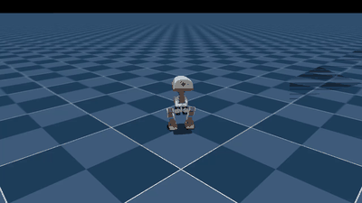

# my-microduck-journal

**A public, verifiable and continuable route to the Microduck's skills.** Every policy here was
trained from scratch on one consumer PC (an RTX 50-series card, WSL2 on Windows 11), without the
private teacher checkpoints the official recipe depends on, and is measured against the official
policies with an open benchmark. The point is not the checkpoints — it is that the whole path is
open: teachers, patches, exact scripts, checkpoint picks, evaluation, and every number and dead end,
so that anyone with one consumer GPU can reproduce it, check it, or continue from it.

<table>
<tr>
<td width="50%"></td>
<td width="50%"></td>
</tr>
<tr>
<td><b>Fast variant</b> (<code>velstand_fast.onnx</code>): pushed at 1.0 m/s on the way to a goal 1.5 m away, up again, on target at 7.5 s</td>
<td><b>Default</b> (<code>velstand_default.onnx</code>, v4): the same exam, on target at 8.4 s</td>
</tr>
</table>

## Contents

1. [At a glance](#at-a-glance)
2. [Results against the official policies](#results-against-the-official-policies)
3. [What is different from the official setup](#what-is-different-from-the-official-setup)
4. [Status](#status)
5. [How it was built](#how-it-was-built)
6. [What we learned](#what-we-learned)
7. [Get the policies](#get-the-policies)
8. [Reproduce it](#reproduce-it)
9. [Repository layout](#repository-layout)
10. [Hardware and timings](#hardware-and-timings)

## At a glance

- **Policies you can use** — [release v0.2](https://github.com/xinhuagu/my-microduck-journal/releases/tag/v0.2):
  one network that walks, gets up from any fall and crouches / tilts on command, in two versions:
  `velstand_default.onnx` (most robust) and `velstand_fast.onnx` (walks at the commanded speed).
- **Measured, not claimed** — one open exam ([`docs/benchmark.md`](docs/benchmark.md)) runs any
  policy through the same 256 randomised ducks × 3 seeds: get-up, push recovery, speed, turning,
  body commands, walking to a goal. The official policies are in the same table.
- **The whole route** — own walk and stand-up teachers, the config patches against upstream, the
  exact pipeline scripts, and a log of every run including the ones that went wrong
  ([`docs/training-log.md`](docs/training-log.md)).
- **Rules fixed in advance** — checkpoints are picked by the exam, never "the last one"; a policy
  becomes the default only if it passes a release gate agreed before the run
  ([`scripts/release_gate.py`](scripts/release_gate.py)).

## Results against the official policies

Same environment, 256 randomised ducks, 3 seeds; full table and raw JSON in
[`docs/benchmark.md`](docs/benchmark.md).

**Walk + get-up policies** (one network for walking, getting up and body commands):

| policy | get-up | push recovered, 1.0 / 1.2 m/s | speed for 0.30 m/s | turn for 0.6 / 1.0 rad/s | crouch for −30 mm | 1.5 m goal after a push |
|---|---|---|---|---|---|---|
| official `velstand.onnx` (v7) | 96 % | 94 / 93 % | 0.14 m/s | 0.05 / 0.38 | −0.7 mm | 94 % |
| **`velstand_default.onnx`** (v4) | **99 %** | **95 / 97 %** | 0.18 m/s | 0.39 / 1.10 | **−28.7 mm** | **96 %** |
| **`velstand_fast.onnx`** (C) | **99 %** | 93 / 93 % | **0.29 m/s** | **0.58 / 1.02** | **−28.7 mm** | 95 % |

**Teachers** (the policies the walk + get-up network learns from):

| | official | ours |
|---|---|---|
| walk teacher: speed for 0.15 / 0.30 / 0.45 m/s | 0.00 / 0.15 / 0.21 | **0.16 / 0.31 / 0.44** (v3) |
| walk teacher: turn for 0.6 / +1.0 / −1.0 rad/s | 0.02 / 0.35 / −0.17 | **0.63 / 1.08 / −1.02** (v3) |
| stand-up teacher: get-up face-down / face-up / on-side | 100 %, median 0.38 / 0.50 / 0.54 s | 100 %, median **0.28 / 0.44 / 0.50 s** (v3) |
| stand-up teacher: crouch for −30 mm | +0.5 mm | **−28.2 mm** (v3) |

In short: the default is level with or ahead of the official policy on every column and crouches,
which no official policy does; the fast variant walks at the commanded speed and turns on the spot,
at the cost of a few points of push recovery.

## What is different from the official setup

| | Official | Here |
|---|---|---|
| Walk teacher | trained with the public recipe; walks at about half the commanded speed | retrained, with a narrow speed reward and slow in-place turns ([`speed.patch`](patches/speed.patch), [`turn.patch`](patches/turn.patch)) — tracks the command |
| Stand-up teacher | needed for the walk + get-up policy, but lives in a **private** project (the official command stops with HTTP 403) | rebuilt here (13 500 iterations), stands up straight ([`standup-stand-straight.patch`](patches/standup-stand-straight.patch)) and follows crouch / tilt commands ([`body-wide.patch`](patches/body-wide.patch)) |
| Walk + get-up policy | distilled from the private teacher | distilled from the own teachers via local checkpoint paths ([`velstand-local-teachers.patch`](patches/velstand-local-teachers.patch)) |
| Evaluation | internal scripts | an open, fixed-seed exam for any ONNX ([`scripts/eval_battery.py`](scripts/eval_battery.py)) |
| Releases | finished ONNX files | ONNX + the exam's raw JSON + checksums, chosen by a gate fixed in advance |
| Tooling | wandb online | offline; everything reproducible from this repository |

Every change is behind a `MICRODUCK_*` environment variable and off by default;
[`patches/all-in-one.patch`](patches/all-in-one.patch) applies all of them at once.

## Status

✅ = done and measured in simulation · 🔄 = in progress

| Area | | Where it stands |
|---|---|---|
| Upstream stack on an RTX 50-series GPU (WSL2) | ✅ | verified with the versions under "Hardware and timings" — [setup](docs/setup-wsl2-rtx5090.md), [pitfalls](docs/pitfalls.md) |
| Walk teacher | ✅ | v3 tracks speed and turns |
| Stand-up teacher | ✅ | v3 gets up in 0.3–0.5 s, crouches, tilts ±20° |
| Walk + get-up policy | ✅ | v4 = `velstand_default.onnx` |
| Crouch / tilt while standing | ✅ | −28.7 mm for −30, within 1° at ±10° / ±20° |
| Walking speed | ✅ | `velstand_fast.onnx`, 0.29 m/s for 0.30 |
| Turning on the spot | ✅ / 🔄 | 0.6 and 1.0 rad/s tracked; 0.3 rad/s still a dead zone (official too) |
| Walk to a goal (20-line controller on top) | ✅ | 100 % reached, 95–96 % after being pushed over on the way |
| Open benchmark | ✅ | 12 policies, official and community included |
| Fast **and** as robust as the default | 🔄 | close: a fast policy with 95–96 % push recovery exists, it misses the gate on turning and crouch |
| Release | ✅ | [v0.2](https://github.com/xinhuagu/my-microduck-journal/releases/tag/v0.2) (earlier: [v0.1](https://github.com/xinhuagu/my-microduck-journal/releases/tag/v0.1)) |

## How it was built

The route, in the order it was done; each step links to the full record.

1. **Set up** the upstream training stack on WSL2 —
   [docs/setup-wsl2-rtx5090.md](docs/setup-wsl2-rtx5090.md).
2. **Walk teacher**, 10 000 iterations with the public recipe; later retrained for turning (v2) and
   for speed (v3) — [walk v3](docs/training-log.md#walk-teacher-v3-the-speed-patch-closes-the-speed-gap-2026-10-15-2335).
3. **Stand-up teacher**, rebuilt because the official one is private; the first version got up into
   a 34° lean, fixed by changing its reward —
   [docs/velstand-without-private-teachers.md](docs/velstand-without-private-teachers.md).
4. **Walk + get-up in one network** (VelStand), distilled from both teachers, then trained on rough
   terrain with actuator backlash — [v2 / v3](docs/training-log.md#velstand-v3--rough-terrain--backlash-2026-10-11-1800).
5. **Body commands** (crouch / tilt): measured first (nobody crouched), then the teacher's rewards
   made command-relative — [v4](docs/training-log.md#velstand-v4-body-commands-inside-the-walk--get-up-network-2026-10-11-2300).
6. **The exam**: a batched, fixed-seed evaluation for any ONNX, run on every official and own policy —
   [docs/benchmark.md](docs/benchmark.md).
7. **Speed**: a walk teacher that tracks the command, carried into the walk + get-up network; the
   push-recovery cost diagnosed and mostly recovered —
   [docs/findings.md](docs/findings.md).
8. **Automated rounds**: candidates trained, swept, examined and released by rule, without manual
   picks — [search](docs/training-log.md#search-for-fast-and-robust-the-anchor-weight-is-the-trade-knob-2026-10-18-2310).


*64 of the 4096 parallel stand-up environments, replayed with an early checkpoint while the same
GPU keeps training. Each duck starts on the ground and has to get up.*

## What we learned

The full write-up is [docs/findings.md](docs/findings.md); the short version:

- **A policy that under-tracks a command is usually doing what the reward prices.** Every walk policy
  walked at ~60 % of the command because the stock speed reward is too wide to notice a 0.1 m/s
  shortfall. A narrow term next to it fixed it.
- **In the walk + get-up network, the walk teacher decides the gait.** Change the teacher and the
  combined policy follows it almost exactly — so a teacher has to be measured before it is used.
- **The fast gait does not make the duck fall more; it makes it get up less.** The ducks that stay
  down lie on the side or back. Found by recording *where* failures end up, not just how many.
- **The walk-teacher weight trades push recovery against turning.** Halving it gives push recovery
  like the default at full speed, but weaker turning.

## Get the policies

From the [Releases page](https://github.com/xinhuagu/my-microduck-journal/releases) (checkpoints
are not in this repository):

| file (v0.2) | what it is |
|---|---|
| `velstand_default.onnx` | **the policy to use**: walks, gets up from any fall, crouch / tilt while standing |
| `velstand_fast.onnx` | the same skills, walks at the commanded speed, recovers a few points fewer push falls |
| `walk_teacher_v3.onnx`, `standup_teacher_v3.onnx` | the two teachers, to distil or compare against |
| `eval_*.json`, `SHA256SUMS.txt` | the exam's raw output for the policies above, and checksums |

```bash
# inside upstream microduck_rl (see "Reproduce it")
uv run scripts/infer_policy.py --walking velstand_default.onnx --new-cmd-obs
```

Run the exam on any policy, yours included:

```bash
bash scripts/eval_battery.sh Mjlab-VelStand-Flat-MicroDuck my_policy.onnx 256 getup,push,tracking,body out.json 0,1,2 my_policy
```

## Reproduce it

```bash
# WSL2 Ubuntu 24.04, NVIDIA driver >= 580 on the Windows side
curl -LsSf https://astral.sh/uv/install.sh | sh
git clone https://github.com/pollen-robotics/microduck_rl && cd microduck_rl
git checkout ceca0170                                  # the upstream commit every run here used
git apply /path/to/my-microduck-journal/patches/all-in-one.patch
UV_HTTP_TIMEOUT=600 uv sync --locked                   # ~2 GB of CUDA wheels on first run

# smoke test first, then a real run
WANDB_MODE=offline uv run train Mjlab-Velocity-Flat-MicroDuck --env.scene.num-envs 64 --agent.max-iterations 5
WANDB_MODE=offline uv run train Mjlab-Velocity-Flat-MicroDuck --env.scene.num-envs 4096
```

Each later step is one script in [`scripts/`](scripts/) (`train_*.sh`, then `pipeline_round*.sh` in
order); the exact command, settings and checkpoint picked for every run are in
[docs/training-log.md](docs/training-log.md). Run names inside the scripts are the ones from this
machine — change them to yours. Viewer settings for WSLg are in [docs/pitfalls.md](docs/pitfalls.md).

## Repository layout

```
docs/
  findings.md                        what the speed rounds showed, and how it was found
  benchmark.md                       the exam: method, how to run it, all results
  training-log.md                    every run: command, settings, time, outcome, checkpoint picked
  velstand-without-private-teachers.md   training walk + get-up without the private teacher
  setup-wsl2-rtx5090.md / pitfalls.md    environment, and every problem hit with its fix
patches/
  all-in-one.patch                   every change in one diff; the per-topic patches next to it
scripts/
  train_*.sh, pipeline_round*.sh     the exact training runs, in order (round 7 = release + search)
  eval_battery.py / .sh              the exam; benchmark_all.sh / benchmark_table.py build the table
  pick_from_battery.py, release_gate.py, release_plan.py, search_board.py
                                     checkpoint picks, the release gate, release by rule, leaderboard
  pushtest.sh, posture_probe.sh, bodypose_probe.sh, turn_probe.sh   quick probes (pushes, posture, body commands, turning)
results/
  benchmark/                         raw JSON of every exam
  *.gif, *.jpg                       the images in this README
```

## Hardware and timings

| | |
|---|---|
| GPU | NVIDIA GeForce RTX 5090, 32 GB (Windows driver 617.42) |
| System | Windows 11, 64 GB RAM, WSL 2.7.13, Ubuntu 24.04 |
| Software | uv 0.12.10, Python 3.12.3, torch 2.9.1+cu128, warp-lang 1.12.0, mjlab 1.3.0, mujoco 3.10.0 |
| Upstream | `microduck_rl` `develop` @ `ceca0170` |

| job (4096 parallel environments) | time |
|---|---|
| walk teacher, 6 000 iterations | 2.5–3 h |
| stand-up teacher, 6 000 + 7 500 iterations | 2 h 30 min + 3 h 02 min |
| walk + get-up policy, 3 000 iterations | about 3 h |
| the full exam, one policy, 3 seeds | about 16 min |

A 16 GB card runs the same recipe with half the parallel environments and proportionally more time.

## Upstream

- Robot software: [microduck](https://github.com/pollen-robotics/microduck)
- RL environments: [microduck_rl](https://github.com/pollen-robotics/microduck_rl) (Apache-2.0; its `AGENTS.md` is the real training manual)
- Simulator: [mjlab](https://github.com/mujocolab/mjlab), [mujoco_warp](https://github.com/google-deepmind/mujoco_warp)
- Official policies: [microduck-policies](https://huggingface.co/pollen-robotics/microduck-policies) (ONNX only)

## License

Apache-2.0 for everything in this repository. Upstream `microduck_rl` code is Apache-2.0; its 3D
model files are CC BY-NC-SA 4.0 and are not redistributed here.
