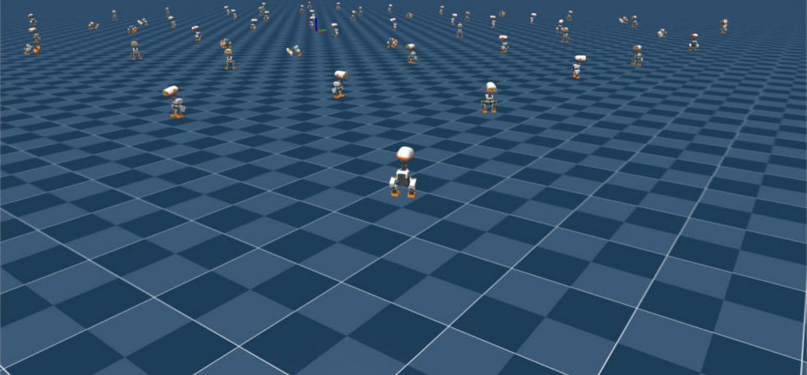

# my-microduck-journal

**A journal of re-training the Microduck's skills from scratch on a consumer PC** — an RTX 5090
under WSL2 on Windows 11 — with my own policies and without the private teacher checkpoints the official recipe depends on.
Every step, number and dead end is written down, so that anyone with a single consumer GPU can
reproduce the pipeline.

## Why train your own

The skills that come with the robot are finished ONNX files, and the viewer can even chain two of
them (walk while a velocity is commanded, stand up when it is zero). That is enough to *watch* a duck
get up. It is not enough to *change* anything:

- **The shipped policies are end points, not starting points.** In the official recipe every new or
  modified skill is distilled from, or warm-started on, teacher checkpoints that live in a private
  wandb project; without them the official training commands stop with an HTTP 403. So the first job
  here was to rebuild those teachers, and every later skill can be trained on this PC.
- **What you don't like, you can fix.** The first fall-recovery policy trained here "stood up" into
  a 34° forward lean. Owning the teacher meant changing its reward
  ([`patches/standup-stand-straight.patch`](patches/standup-stand-straight.patch)) and re-training,
  instead of living with it.
- **Training budget becomes a choice.** The stand-up teacher here has 13 500 iterations against the
  ≈ 10 000 of the upstream checkpoint it replaces; VelStand v2 gets 6 000 on top of a
  10 000-iteration walk, then 3 000 more on rough terrain with actuator backlash. On one consumer
  GPU each of those is a few hours.
- **One network instead of a hand-off.** Chaining walk + stand-up in the viewer switches networks in
  the middle of a fall. VelStand learns both in one network, which is what runs on the real robot,
  and training it is exactly what needs the teachers above.
- **Reproducible end to end.** Offline wandb, every command, number and dead end in `docs/`, so
  the next person needs neither the private project nor a workstation.

What is different from the official setup:

| | Official (upstream) | Here |
|---|---|---|
| Hardware | Linux workstations (COACH2, RTX 5090) | Windows 11 + WSL2 Ubuntu 24.04, RTX 5090 + Intel iGPU (hence the WSLg pitfalls) |
| Walking policy | `alpha_walking` from wandb `441tzs6d` | `first-walk`, trained here from scratch, 4096 envs × 10 000 iterations |
| Fall recovery | VelStand distilled from a **private** stand-up expert (`69u48n8l`) | own `StandUp` teacher (6 000 iterations) + VelStand with local checkpoints — gets up 8/8 in the push test |
| Body-pose control | tilt from the shipped stand expert, crouch "not learned" | teacher rewards made command-relative, crouch taught by the own teacher (in progress) |
| Tooling | wandb online, internal eval scripts | `WANDB_MODE=offline`, everything reproducible from this repo |



*64 of the 4096 parallel `Mjlab-StandUp-Flat-MicroDuck` environments, replayed with the
iteration-500 checkpoint in mjlab's native viewer (`uv run play ... --num-envs 64 --viewer native`)
while the same GPU keeps training. Each duck starts an episode on the ground and has to get up.*

## Status (2026-10-11)

| Milestone | State | Notes |
|---|---|---|
| RTX 5090 (Blackwell, `sm_120`) runs the official `microduck_rl` stack | ✅ verified | `warp-lang 1.12.0` / `mjlab 1.3.0` / `torch 2.9.1+cu128`, WSL2 Ubuntu 24.04 — see [docs/setup-wsl2-rtx5090.md](docs/setup-wsl2-rtx5090.md) |
| Walking policy (`Mjlab-Velocity-Flat-MicroDuck`) | ✅ trained | 4096 envs × 10 000 iterations, all 41 checkpoints exported to ONNX — see [docs/training-log.md](docs/training-log.md) |
| Fall recovery (`Mjlab-VelStand-*`) | ✅ trained | The official recipe distils a stand-up expert from a **private** wandb project (HTTP 403), so a `StandUp` teacher was trained here first (6 000 iterations, 2 h 30) and VelStand warm-started from the walk policy with local teachers (3 000 iterations, 1 h 35). Push test: **gets up 8/8** standing and walking, where the walk policy stays down 8/8 — but v1 "stands" pitched 34° forward with the head tucked (the teacher's lean basin). Teacher v2 with stronger upright rewards (13 500 iterations in total) ends every get-up at pitch ≈ 0° and stays upright 8/8 in the push test; VelStand v2 (6 000 iterations) and v3 (rough terrain + backlash) are training with it — see [docs/velstand-without-private-teachers.md](docs/velstand-without-private-teachers.md) and [docs/training-log.md](docs/training-log.md) |
| Body-pose commands (crouch / tilt while standing) | 🔄 in progress | Measured: neither the walk+get-up policy nor the teacher crouches, and tilt tracks only to ~10°. The teacher's fixed-pose rewards are made command-relative ([`patches/body-wide.patch`](patches/body-wide.patch)); teacher v3 and VelStand v4 are queued after VelStand v3 — see [docs/training-log.md](docs/training-log.md#body-pose-commands-what-the-policies-actually-do-with-them-2026-10-11-1405) |

## Hardware & software

| | |
|---|---|
| GPU | NVIDIA GeForce RTX 5090, 32 GB, driver 617.42 (Windows) |
| CPU / RAM | 64 GB RAM, Windows 11 (build 26200) |
| WSL | WSL 2.7.13, kernel 6.18.33.2, WSLg 1.0.73, Ubuntu 24.04 LTS |
| Python stack | uv 0.12.10, Python 3.12.3, torch 2.9.1+cu128, warp-lang 1.12.0, mjlab 1.3.0, mujoco 3.10.0 |
| `microduck_rl` | `develop` @ `ceca0170` (2026-10-09); first runs were on `29e887e` (2026-09-02) |

## Headline numbers

- **Smoke test** (5 iterations × 64 envs): 42 s wall-clock, Warp reports `"cuda:0": "NVIDIA GeForce RTX 5090" (32 GiB, sm_120)`, CUDA Toolkit 12.9. No `no kernel image` errors.
- **Full walk training** (4096 envs): iteration 0 → 1000 in 30 min, 0 → 2500 in 69 min, i.e. roughly **2.5–3 h for the 6000-iteration budget** the upstream docs recommend for gaits. (Upstream README says "about 1–2 h"; a 4090 under WSL2 was reported at ~4 h 23 min.)
- **Export**: ~13 s per checkpoint (`scripts/export.py`, normalizer baked in), ONNX ≈ 775 KB each.
- **Stand-up teacher**: 6 000 iterations in 2 h 30 min, plus 7 500 stand-straight iterations in 3 h 02 min (1.30 s collection + 0.07 s learning per iteration); **VelStand** (walk + get-up): 3 000 iterations in 1 h 35 min, 1.70 s/iteration including the behaviour-cloning passes.

## Repository layout

```
docs/
  setup-wsl2-rtx5090.md             environment, install, smoke test
  pitfalls.md                       every problem hit so far, with the fix
  training-log.md                   one row per run: task, envs, iterations, time, outcome
  velstand-without-private-teachers.md   how to train fall recovery without the private wandb teachers
scripts/
  export_all.sh                     export every checkpoint of a run to ONNX
  run_viewer.sh                     launch the CPU MuJoCo viewer with the right env vars
  wslg_copymode.ps1                 check / fix the WSLg copy-mode blank window without wsl --shutdown
patches/                            config diffs against upstream microduck_rl (local teachers, stand-straight rewards)
results/                            screenshots used in this README and the docs
```

Checkpoints (`.pt`) and exported policies (`.onnx`) are **not** in this repo; they will be published
on the Hugging Face Hub via `uv run publish`.

## Quick start (what actually worked here)

```bash
# WSL2 Ubuntu 24.04, NVIDIA driver >= 580 on the Windows side
curl -LsSf https://astral.sh/uv/install.sh | sh
git clone https://github.com/pollen-robotics/microduck_rl && cd microduck_rl
UV_HTTP_TIMEOUT=600 uv sync --locked              # ~2 GB of CUDA wheels on first run

# smoke test (always first), then the real thing
WANDB_MODE=offline uv run train Mjlab-Velocity-Flat-MicroDuck --env.scene.num-envs 64 --agent.max-iterations 5
WANDB_MODE=offline uv run train Mjlab-Velocity-Flat-MicroDuck --env.scene.num-envs 4096

# export + drive it in the CPU viewer (see docs/pitfalls.md for the WSLg env vars)
uv run scripts/export.py Mjlab-Velocity-Flat-MicroDuck --checkpoint-file logs/rsl_rl/velocity/<run>/model_10000.pt --onnx-file walk.onnx
MESA_D3D12_DEFAULT_ADAPTER_NAME=NVIDIA GALLIUM_DRIVER=d3d12 uv run scripts/infer_policy.py --walking walk.onnx --new-cmd-obs
```

## Upstream

- Robot software: [pollen-robotics/microduck](https://github.com/pollen-robotics/microduck)
- RL environments: [pollen-robotics/microduck_rl](https://github.com/pollen-robotics/microduck_rl) (Apache-2.0; its `AGENTS.md` is the real training manual)
- Simulator / framework: [mujocolab/mjlab](https://github.com/mujocolab/mjlab), [google-deepmind/mujoco_warp](https://github.com/google-deepmind/mujoco_warp)
- Official policies: [pollen-robotics/microduck-policies](https://huggingface.co/pollen-robotics/microduck-policies) (ONNX only)

## License

Apache-2.0 for everything in this repository. Upstream `microduck_rl` code is Apache-2.0; its 3D
model files are CC BY-NC-SA 4.0 and are not redistributed here.
