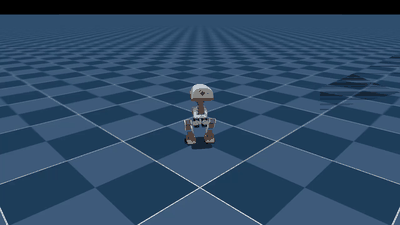

# my-microduck-journal

**A public, verifiable and continuable route to the Microduck's skills.** Every policy here was
trained from scratch on one consumer PC (an RTX 50-series card under WSL2 on Windows 11), without
the private teacher checkpoints the official recipe depends on, and is measured with an open
benchmark against the official policies. The point is not the checkpoints — it is that the whole
path is open: the teachers, the patches, the exact scripts and checkpoint picks, the evaluation,
and every number and dead end along the way, so that anyone with a single consumer GPU can
reproduce it, verify it, or continue training from it. The exact card and the times it gave are in
the hardware table below; a 16 GB card runs the same recipe with half the parallel environments
and proportionally more time.

## Why train your own

The skills that come with the robot are finished ONNX files, and the viewer can even chain two of
them (walk while a velocity is commanded, stand up when it is zero). That is enough to *watch* a duck
get up. It is not enough to *change* anything:

- **The shipped policies are end points, not starting points.** The basic skills (walking,
  stand-up) train from scratch with the public recipe. The *composite* ones do not: VelStand (walk +
  get-up in one network) is distilled from, and warm-started on, teacher checkpoints that live in a
  private wandb project, and the official training command stops with an HTTP 403 without them. So
  the first job here was to rebuild those teachers; after that, composite skills can be trained on
  this PC too.
- **What you don't like, you can fix.** The first fall-recovery policy trained here "stood up" into
  a 34° forward lean. Owning the teacher meant changing its reward
  ([`patches/standup-stand-straight.patch`](patches/standup-stand-straight.patch)) and re-training,
  instead of living with it.
- **Training budget becomes a choice.** The stand-up teacher here has 13 500 iterations against the
  ≈ 10 000 of the upstream checkpoint it replaces; VelStand v2 gets 6 000 on top of a
  10 000-iteration walk, then 3 000 more on rough terrain with actuator backlash. On one consumer
  GPU each of those is a few hours.
- **One network instead of a hand-off.** Chaining walk + stand-up in the viewer switches networks in
  the middle of a fall. VelStand learns both in one network, which is what runs on the real robot,
  and training it is exactly what needs the teachers above.
- **Reproducible from the record.** Offline wandb, the exact scripts in `scripts/`, every number
  and dead end in `docs/`, so the next person needs neither the private project nor a workstation.
  (Still missing: the checkpoints themselves and a fixed-seed evaluation — see Status.)

What is different from the official setup:

| | Official (upstream) | Here |
|---|---|---|
| Hardware | Linux workstations (COACH2, RTX 5090) | Windows 11 + WSL2 Ubuntu 24.04, RTX 5090 + Intel iGPU (hence the WSLg pitfalls) |
| Walking policy | `alpha_walking` from wandb `441tzs6d` (3 750 iterations) | `first-walk`, trained here from scratch, 4096 envs × 10 000 iterations — faster and turns in place where the official one does not (table below) |
| Fall recovery | VelStand distilled from a **private** stand-up expert (`69u48n8l`) | own `StandUp` teacher (13 500 iterations) + VelStand with local checkpoints — v1 got back to standing height after every fall but into a 34° lean; v2 (teacher with command-independent upright rewards) gets up straight, 5/5 falls while walking in the 8-push smoke test |
| Body-pose control | tilt from the shipped stand expert, crouch "not learned" | teacher rewards made command-relative, crouch taught by the own teacher — v4 crouches 29 mm and tilts ±20° |
| Tooling | wandb online, internal eval scripts | `WANDB_MODE=offline`, everything reproducible from this repo |


*64 of the 4096 parallel `Mjlab-StandUp-Flat-MicroDuck` environments, replayed with the
iteration-500 checkpoint in mjlab's native viewer (`uv run play ... --num-envs 64 --viewer native`)
while the same GPU keeps training. Each duck starts an episode on the ground and has to get up.*

## Status (2026-10-15)

✅ = verified in simulation here · 🔄 = training / being tested.

| Milestone | State | Notes |
|---|---|---|
| RTX 5090 (Blackwell, `sm_120`) runs the official `microduck_rl` stack | ✅ verified | `warp-lang 1.12.0` / `mjlab 1.3.0` / `torch 2.9.1+cu128`, WSL2 Ubuntu 24.04 — see [docs/setup-wsl2-rtx5090.md](docs/setup-wsl2-rtx5090.md) |
| Walking policy (`Mjlab-Velocity-Flat-MicroDuck`) | ✅ trained | 4096 envs × 10 000 iterations, all 41 checkpoints exported to ONNX — see [docs/training-log.md](docs/training-log.md) |
| Fall recovery (`Mjlab-VelStand-*`) | ✅ trained | The official recipe distils a stand-up expert from a **private** wandb project (HTTP 403), so the teachers were rebuilt here: a `StandUp` teacher (13 500 iterations, with stand-straight and command-relative rewards) and the walk teacher. The current walk + get-up policy is **VelStand v4** (release v0.1): get-up 99 % from face-down / face-up / on-side in a median 0.5 s, straight at the end; 95–97 % of push falls recovered at 1.0–1.2 m/s (official v7: 93–94 %). The way there — the 34° lean of v1, the stand-straight fix, rough terrain + backlash — is in [docs/velstand-without-private-teachers.md](docs/velstand-without-private-teachers.md) and [docs/training-log.md](docs/training-log.md) |
| Body-pose commands (crouch / tilt while standing) | ✅ trained | Measured first: neither the walk+get-up policy nor the teacher crouched, and tilt tracked only to ~10°. With the teacher's fixed-pose rewards made command-relative ([`patches/body-wide.patch`](patches/body-wide.patch)), teacher v3 crouches and tilts; **VelStand v4** distilled from it crouches −28.6 mm for −30, tracks roll / pitch to within 1° at ±10° and ±20°, and recovers 94–98 % of push falls — see [docs/training-log.md](docs/training-log.md#velstand-v4-body-commands-inside-the-walk--get-up-network-2026-10-11-2300) |
| Benchmark (256 envs × 3 seeds, any ONNX) | ✅ published | 10 policies — official, own, community — through one exam; v4 level or ahead of the official v7 on every column — see [docs/benchmark.md](docs/benchmark.md) |
| Release | ✅ v0.1 | `velstand_v4.onnx` + v5 variant + teachers + evaluation JSONs + checksums — [releases/tag/v0.1](https://github.com/xinhuagu/my-microduck-journal/releases/tag/v0.1) |
| Navigation layer (walk to a goal) | ✅ measured | 20 lines on top of the policy turn a goal into velocity commands; v4 reaches a goal 1.5 m away 100 % of the time, 96 % after being pushed over on the way (official v7: 97 / 94 %) — see the GIF below and the benchmark's goal columns |
| Turning (`patches/turn.patch`) | 🔄 partial | A walk teacher trained with slow in-place turns and a yaw-only fine term turns 0.6 rad/s → 0.65 and ±1.0 symmetrically with a third of the yaw drift, and VelStand v5 anchored to it inherits that — at the cost of walking speed (0.30 → 0.12 m/s). The 0.3 rad/s dead zone is unchanged. Next walk teacher has to be fast and turn — see [docs/training-log.md](docs/training-log.md#velstand-v5-the-turning-anchor-measured-2026-10-12-2200) |
| Walking speed (`patches/speed.patch`) | ✅ in a variant | Every walk policy, official included, walked at ~60 % of the command. A fine forward-speed term in the walk teacher, carried into VelStand by the anchor, gives **v6: 0.30 m/s for 0.30, 0.41 for 0.45**, consistent turning, and a 1.5 m goal in 6.2 s (v4 9.7 s, official 13.8 s) — but 88–89 % push recovery against v4's 95–97 %, so v4 stays the release. Two v0.2 candidates showed that the recovery loss comes with the fast walk anchor itself, not with the speed reward; no candidate passed the release gate yet. See [docs/training-log.md](docs/training-log.md#v02-candidates-the-fast-anchor-is-what-costs-push-recovery-2026-10-17-2200) |

## Fall, get up, walk to the goal, stop



*One duck, policy v4, recorded by the evaluation script: a goal 1.5 m away, a 1.0 m/s push after
2 s, up again in about a second, on target at 8.4 s, then standing still. The navigation layer is
20 lines on top of the policy (heading error → turn, distance → speed, inside 10 cm → stop); the
policy itself only sees velocity commands. Over 256 ducks × 3 seeds, v4 reaches the goal 100 % of
the time unpushed and 96 % after the push — see the benchmark's goal columns.*

## Benchmark

[`docs/benchmark.md`](docs/benchmark.md) is one fixed exam for every policy that speaks the
Microduck contract — 256 randomised ducks, three seeds, forced spawns, pushes and commands — and
[`scripts/eval_battery.py`](scripts/eval_battery.py) runs it on any `.onnx` in one command. Official,
own and community policies, same numbers, same code path (headline columns; the full table and the
raw JSON are in the doc and in `results/benchmark/`):

| policy | get-up | push 1.0 / 1.2 m/s recovered | speed at 0.30 | turn 0.6 / 1.0 rad/s | crouch −30 mm | pitch ±10° | 1.5 m goal, pushed |
|---|---|---|---|---|---|---|---|
| official `velstand.onnx` (v7) | 96 % | 94 / 93 % | 0.14 m/s | 0.05 / 0.38 | −0.7 mm | 8.0° | 94 % |
| **ours v4** (release v0.1) | **99 %** | **95 / 97 %** | **0.18 m/s** | 0.39 / 1.10 | **−28.7 mm** | **10.0°** | **96 %** |
| ours v6 (speed variant) | 97 % | 89 / 88 % | **0.30 m/s** | **0.60 / 1.08** | −24.2 mm | 9.7° | 92 % |
| ours v5 (turning variant) | 95 % | 89 / 89 % | 0.12 m/s | **0.68 / 1.12** | −25.8 mm | 9.8° | 90 % |
| ours v2 | 97 % | 85 / 86 % | 0.18 m/s | 0.38 / 0.92 | −0.5 mm | 3.1° | 89 % |

```bash
bash scripts/eval_battery.sh Mjlab-VelStand-Flat-MicroDuck my_policy.onnx 256 getup,push,tracking,body out.json 0,1,2 my_policy
```

## Measured against the official policies

The official ONNX policies (Hugging Face `pollen-robotics/microduck-policies`) run through the same
batched battery as ours: identical environment, 256 randomised ducks, seed 0, 8 s per command.
Walking policies first (`Mjlab-Velocity-Flat-MicroDuck` environment):

| command | official `alpha_walking` | ours `first_walk_10000` |
|---|---|---|
| walk 0.15 / 0.30 / 0.45 m/s → achieved | 0.00 / 0.15 / 0.21 m/s | **0.10 / 0.20 / 0.27 m/s** |
| turn in place 0.3 / 0.6 / 1.0 / −1.0 rad/s → achieved | 0.00 / 0.02 / 0.35 / −0.17 | 0.05 / **0.57 / 1.00 / −1.00** |
| falls during the trial | 0 % | 0 % |

- Same recipe, more training: the walk recipe is unchanged here; ours ran 10 000 iterations against
  the official checkpoint's 3 750. The official policy does not step at all for a 0.15 m/s command
  and has the in-place turning dead zone its own notes describe; ours tracks 0.6 rad/s and above,
  symmetrically. Both under-track speed (0.30 → 0.20 / 0.15) and both ignore 0.3 rad/s.
- Caveat: the official checkpoint comes from an older commit of the recipe, so the environment's
  randomisation may differ slightly from what it was trained in.

Walk + get-up policies (`Mjlab-VelStand-Flat-MicroDuck` environment; the official file is their
deployed v7, ours is v2 `model_5750`):

| | official `velstand.onnx` (v7) | ours v2 | **ours v4** |
|---|---|---|---|
| get-up from face-down / face-up / on-side | 100 / 93 / 95 % | 99 / 93 / 93 % | **100 / 98 / 99 %** |
| recovered after a 1.0 / 1.2 m/s push, standing | 92 / 92 % | 87 / 76 % | **94 / 98 %** |
| recovered after a 1.0 / 1.2 m/s push, walking | 94 / 93 % | 84 / 86 % | **94 / 97 %** |
| walk 0.15 / 0.30 / 0.45 m/s → achieved | 0.02 / 0.14 / 0.22 m/s | 0.09 / 0.18 / 0.25 | 0.06 / **0.18 / 0.24** |
| turn in place 0.3 / 0.6 / 1.0 / −1.0 rad/s → achieved | 0.00 / 0.05 / 0.39 / −0.34 | 0.02 / 0.46 / 0.91 / −1.00 | 0.00 / **0.40 / 1.09 / −0.91** |
| body tilt ±10° → achieved | +9.9 / −6.2° pitch, ±7.8° roll | +3.7 / −2.5°, ±1.6° | **+10.2 / −9.6° pitch, ±9.6° roll** |
| body tilt ±20° → achieved | +16.9 / −15.4° | +4.2 / −2.0° | **+20.4 / −19.0°** |
| crouch −30 mm → achieved | −0.6 mm | −0.4 mm | **−28.6 mm** |

Stand-up teachers (`Mjlab-StandUp-Flat-MicroDuck` environment; these are the policies the walk +
get-up networks are distilled from):

| | official `alpha_stand` | ours teacher v3 |
|---|---|---|
| get-up from face-down / face-up / on-side | 100 / 100 / 100 %, median 0.38 / 0.50 / 0.54 s | 100 / 100 / 100 %, median **0.28 / 0.44 / 0.50 s** |
| body tilt ±10° / ±20° → achieved | ±9.2° roll, +9.5 / −9.1°, +18.4 / −18.6° pitch | ±9.5° roll, +10.0 / −8.9°, +19.7 / −19.4° pitch |
| crouch −30 mm / raise +20 mm → achieved | +0.5 / +1.8 mm (none) | **−28.2 / +12.4 mm** |

So, measured the same way: v4 is level with or ahead of the official policy on every row — get-up,
push recovery, speed, turning, tilt — and crouches, which no official policy does. (v5, the same
network re-anchored to a walk teacher trained for turning, turns more consistently — 0.6 rad/s →
0.68 for every duck, drift a third of v4's — but walks slower, 0.12 m/s, and recovers fewer push
falls; v4 remains the policy to use.) Still open on
both sides: the 0.3 rad/s turning dead zone and the gap between commanded and achieved walking speed
(both track 0.30 m/s at about 0.18 / 0.14). Full tables with per-env spread:
[docs/training-log.md](docs/training-log.md#official-policies-measured-with-the-same-battery-2026-10-11-2130),
v4 details in [its section](docs/training-log.md#velstand-v4-body-commands-inside-the-walk--get-up-network-2026-10-11-2300).

## Hardware & software

| | |
|---|---|
| GPU | NVIDIA GeForce RTX 5090, 32 GB, driver 617.42 (Windows) |
| CPU / RAM | 64 GB RAM, Windows 11 (build 26200) |
| WSL | WSL 2.7.13, kernel 6.18.33.2, WSLg 1.0.73, Ubuntu 24.04 LTS |
| Python stack | uv 0.12.10, Python 3.12.3, torch 2.9.1+cu128, warp-lang 1.12.0, mjlab 1.3.0, mujoco 3.10.0 |
| `microduck_rl` | `develop` @ `ceca0170` (2026-10-09); first runs were on `29e887e` (2026-09-02) |

## Headline numbers

- **Smoke test** (5 iterations × 64 envs): 42 s wall-clock, Warp reports `"cuda:0": "NVIDIA GeForce RTX 5090" (32 GiB, sm_120)`, CUDA Toolkit 12.9. No `no kernel image` errors.
- **Full walk training** (4096 envs): iteration 0 → 1000 in 30 min, 0 → 2500 in 69 min, i.e. roughly **2.5–3 h for the 6000-iteration budget** the upstream docs recommend for gaits. (Upstream README says "about 1–2 h"; a 4090 under WSL2 was reported at ~4 h 23 min.)
- **Export**: ~13 s per checkpoint (`scripts/export.py`, normalizer baked in), ONNX ≈ 775 KB each.
- **Stand-up teacher**: 6 000 iterations in 2 h 30 min, plus 7 500 stand-straight iterations in 3 h 02 min (1.30 s collection + 0.07 s learning per iteration); **VelStand** (walk + get-up): v1 3 000 iterations in 1 h 35 min, 1.70 s/iteration including the behaviour-cloning passes; v2 6 000 iterations in ≈ 3 h 20 min.

## Repository layout

```
docs/
  setup-wsl2-rtx5090.md             environment, install, smoke test
  pitfalls.md                       every problem hit so far, with the fix
  training-log.md                   one row per run: task, envs, iterations, time, outcome
  velstand-without-private-teachers.md   how to train fall recovery without the private wandb teachers
  benchmark.md                      the policy benchmark: method, how to run it, results
scripts/
  export_all.sh                     export every checkpoint of a run to ONNX
  run_viewer.sh / tmux_viewer.sh    CPU MuJoCo viewer with the right env vars (tmux variant takes injected keys)
  train_standup_teacher.sh          teacher v1 (6 000 iterations from scratch)
  train_standup_teacher_v2_straight.sh   teacher v2 fine-tune (stand-straight rewards)
  train_velstand_v1.sh              VelStand v1 (warm start from the walk, local teachers)
  pipeline_round1_*.sh              teacher v2 → continue → VelStand v2 → v3, with probes and push tests
  pipeline_round1b_resume_after_sleep.sh   the resume after the PC went to sleep mid-run
  pipeline_round2_body_pose.sh      teacher v3 (body-pose) → VelStand v4
  pipeline_round3_turning.sh        walk teacher v2 (yaw fixes) → sweeps → VelStand v5
  pipeline_round4_speed.sh          walk teacher v3 (speed + mild turn) → battery gate → VelStand v6 → battery
  pushtest.sh                       8 random pushes in the viewer: moved / went down / upright at the end
  posture_probe.sh                  trunk height, pitch, roll and joint angles before and after pushes
  bodypose_probe.sh                 commanded vs measured crouch / tilt
  turn_probe.sh / turn_sweep.sh     in-place yaw rate and straight-walk drift, per checkpoint
  eval_battery.py / .sh             batched, fixed-seed battery: get-up per spawn type, push falls, tracking, body commands
  benchmark_all.sh / benchmark_table.py   run every policy through the battery (3 seeds) and build the table
  wslg_copymode.ps1                 check / fix the WSLg copy-mode blank window without wsl --shutdown
patches/                            config diffs against upstream microduck_rl, applied in this order:
  velstand-local-teachers.patch     MICRODUCK_STAND_EXPERT / MICRODUCK_WALK_ANCHOR = local checkpoint paths
  standup-stand-straight.patch      MICRODUCK_STANDUP_STRAIGHT=1 (teacher v2)
  body-wide.patch                   MICRODUCK_BODY_WIDE=1 (teacher v3 / VelStand v4, in progress)
  turn.patch                        MICRODUCK_TURN=1 (walk teacher v2 / VelStand v5)
  speed.patch                       MICRODUCK_SPEED=1 (walk teacher v3 / VelStand v6, in progress)
results/                            screenshots used in this README and the docs
```

Checkpoints (`.pt`) are not in this repo. The exported policies are on the
[Releases page](https://github.com/xinhuagu/my-microduck-journal/releases): **v0.1** has `velstand_v4.onnx`
(the policy to use), the v5 turning variant, both teachers, the evaluation JSONs and sha256 sums,
with the training provenance and the comparison table in the notes.

## Quick start (what actually worked here)

```bash
# WSL2 Ubuntu 24.04, NVIDIA driver >= 580 on the Windows side
curl -LsSf https://astral.sh/uv/install.sh | sh
git clone https://github.com/pollen-robotics/microduck_rl && cd microduck_rl
git checkout ceca0170                             # the upstream commit every run below used
git apply /path/to/my-microduck-journal/patches/velstand-local-teachers.patch
git apply /path/to/my-microduck-journal/patches/standup-stand-straight.patch
git apply /path/to/my-microduck-journal/patches/body-wide.patch   # only needed for the body-pose round
git apply /path/to/my-microduck-journal/patches/turn.patch        # only needed for the turning round
UV_HTTP_TIMEOUT=600 uv sync --locked              # ~2 GB of CUDA wheels on first run

# smoke test (always first), then the real thing
WANDB_MODE=offline uv run train Mjlab-Velocity-Flat-MicroDuck --env.scene.num-envs 64 --agent.max-iterations 5
WANDB_MODE=offline uv run train Mjlab-Velocity-Flat-MicroDuck --env.scene.num-envs 4096

# export + drive it in the CPU viewer (see docs/pitfalls.md for the WSLg env vars)
uv run scripts/export.py Mjlab-Velocity-Flat-MicroDuck --checkpoint-file logs/rsl_rl/velocity/<run>/model_10000.pt --onnx-file walk.onnx
MESA_D3D12_DEFAULT_ADAPTER_NAME=NVIDIA GALLIUM_DRIVER=d3d12 uv run scripts/infer_policy.py --walking walk.onnx --new-cmd-obs
```

The full order of runs, each with the exact command, is in [docs/training-log.md](docs/training-log.md)
and the scripts above: walk (10 000 iterations) → `train_standup_teacher.sh` (6 000) →
`train_standup_teacher_v2_straight.sh` (1 500, then `pipeline_round1_*.sh` continues it by 6 000 and
trains VelStand v2 / v3) → `pipeline_round2_body_pose.sh`. Every pipeline step runs `pushtest.sh`
and `posture_probe.sh` on the result and appends to `logs/pipeline*.log`. Run names and checkpoint
numbers inside the scripts are the ones from this machine; change them to yours.

## Upstream

- Robot software: [pollen-robotics/microduck](https://github.com/pollen-robotics/microduck)
- RL environments: [pollen-robotics/microduck_rl](https://github.com/pollen-robotics/microduck_rl) (Apache-2.0; its `AGENTS.md` is the real training manual)
- Simulator / framework: [mujocolab/mjlab](https://github.com/mujocolab/mjlab), [google-deepmind/mujoco_warp](https://github.com/google-deepmind/mujoco_warp)
- Official policies: [pollen-robotics/microduck-policies](https://huggingface.co/pollen-robotics/microduck-policies) (ONNX only)

## License

Apache-2.0 for everything in this repository. Upstream `microduck_rl` code is Apache-2.0; its 3D
model files are CC BY-NC-SA 4.0 and are not redistributed here.
