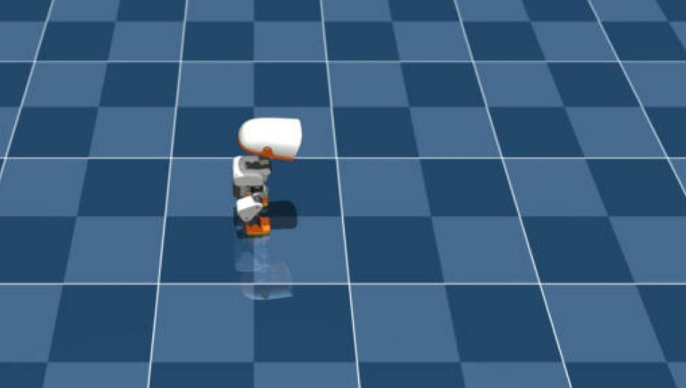
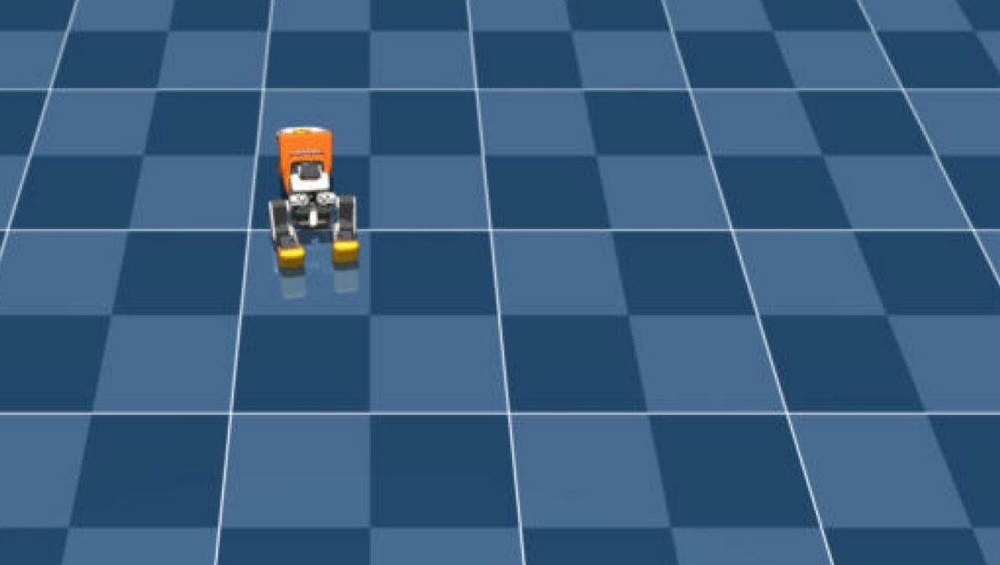

# Training log

All runs: `microduck_rl`, RTX 5090, WSL2 Ubuntu 24.04, `WANDB_MODE=offline`. Iterations are PPO
iterations (24 env-steps each). Checkpoints every 250 iterations.

| Date | Run | Task | Envs | Iterations | Wall-clock | Outcome |
|---|---|---|---|---|---|---|
| 2026-09-06 | `velocity` | `Mjlab-Velocity-Flat-MicroDuck` | 4096 | 4 (aborted) | — | first launch, stopped early |
| 2026-09-07 | `smoke-test` | `Mjlab-Velocity-Flat-MicroDuck` | 64 | 5 | < 1 min | stack verified |
| 2026-09-07 → 09-08 | **`first-walk`** | `Mjlab-Velocity-Flat-MicroDuck` | 4096 | **10 000** | 0→1000: 30 min · 0→2500: 69 min · paused overnight · ended 09-08 23:42 | walks; falls on a `P` push and cannot get up (expected for Velocity) |
| 2026-10-10 | smoke after `git pull` to `ceca0170` | `Mjlab-Velocity-Flat-MicroDuck` | 64 | 5 | 42 s | OK, 1.5–1.75 k steps/s |
| 2026-10-10 | export-all | — | — | 41 checkpoints → ONNX | 41 × ~13 s ≈ 9 min | `exports/first_walk_{0..10000}.onnx`, 793 766 B each |
| 2026-10-10 | smoke | `Mjlab-VelStand-Flat-MicroDuck` | 64 | — | 14 s | **failed**: wandb 403 on the private teacher checkpoints |
| 2026-10-10 23:57 → 10-11 02:28 | **`microduck_stand`** (stand-up teacher) | `Mjlab-StandUp-Flat-MicroDuck` | 4096 | 6 000 (last checkpoint `model_5999.pt`) | **2 h 30 min**, 1.42–1.5 s/iteration, 25 checkpoints | push test below: 4500 and 5999 get up 8/8, 3000 sits 8/8 |
| 2026-10-11 02:41 → 04:16 | **`velstand`** (walk + get-up) | `Mjlab-VelStand-Flat-MicroDuck` | 4096 | 3 000 (last checkpoint `model_2999.pt`) | **1 h 35 min**, 1.70 s/iteration, 13 checkpoints | warm start from `first-walk/model_10000.pt`, expert `microduck_stand/model_5999.pt`, anchor `model_10000.pt`; **gets up 8/8 standing and 8/8 walking** — push tests below |
| 2026-10-11 07:59 → 08:35 | **`microduck_stand` v2** (stand straight) | `Mjlab-StandUp-Flat-MicroDuck` + `MICRODUCK_STANDUP_STRAIGHT=1` | 4096 | 1 500 | 36 min, warm start from `model_5999.pt` | **ends upright** — posture probe after pushes: mean \|pitch\| 0.2° (v1: 34°), neck back at 0°; `upright_sharp` reward 0.10 → 4.75 of 5, mean reward 4 → 89. Fix: upright_sharp 5.0 (curriculum pinned), composite upright_std 0.25, head_pose_tracking 2.0 / fine_std 0.15 |
| 2026-10-11 08:37 → 11:02 | **`microduck_stand` v2** (continued) | same | 4096 | +6 000 (→ 7 498) | 2 h 26 min, resume from `model_1499.pt` | **final teacher** `model_7498.pt`, total budget 6 000 + 1 500 + 6 000 = 13 500 iterations. Probe: stands at pitch 0.6° throughout, neither probe push takes it down; push test: went down 1/8 (to 46 mm, back up), upright at end **8/8** |
| 2026-10-11 11:04 → 14:32 | **`velstand` v2** (walk + get-up) | `Mjlab-VelStand-Flat-MicroDuck` | 4096 | 6 000 | 1 h 30 + 1 h 50 (the PC went to sleep at iteration 2 784; resumed from `model_2750.pt` at 12:42, curricula continued) | warm start from `first-walk/model_10000.pt`, expert = teacher v2 `model_7498.pt`. **Gets up straight**: walking pushes down 5/8, back up 5/5 within ≈ 1 s at pitch 1–3°; standing pushes down 0/8. `recovery_success` 0.018 (v1: 0.003). Lost the tilt tracking v1 had (10° → 3.6°) — see the body-pose section |
| 2026-10-11 14:35 → 17:50 | **`velstand` v3** (rough + backlash) | `Mjlab-VelStand-Rough-Backlash-MicroDuck` | 4096 | 3 000 | **3 h 15 min**, 3.7 s/iteration (2.2× the flat task) | warm start from v2 `model_5999.pt`, same teachers. On the flat test scene: standing pushes down 2/8, walking (0.14 m/s) down 6/8, upright 8/8 both, get-ups straight (pitch 1–2°). Sweep → **use `model_2500`** (drift −0.01; 2999 −0.16). `recovery_success` 0.019 |
| 2026-10-11 17:53 → 19:11 | **`microduck_stand` v3** (body-wide) | `Mjlab-StandUp-Flat-MicroDuck` + `MICRODUCK_STANDUP_STRAIGHT=1` + `MICRODUCK_BODY_WIDE=1` | 4096 | 3 000 | 1 h 18 min, warm start from `model_7498.pt` | **stands straight (0.4°) and tracks the body command**: crouch −30 mm → −28.9 mm, pitch ±10° → 9.9 / −8.8°, ±20° → 19.5 / −19.3°, roll ±10° → 9.6 / −9.4°, raise +20 mm → +12.5 mm (teacher v2: −2 mm, 3°). `body_pose_tracking` 3.25 of 4 |
| 2026-10-11 19:13 → 22:50 | **`velstand` v4** (body-wide) | `Mjlab-VelStand-Rough-Backlash-MicroDuck` + `MICRODUCK_BODY_WIDE=1` | 4096 | 3 000 | 3 h 37 min (GPU shared with the evaluation runs) | warm start from v3 `model_2999.pt`, expert = teacher v3. **Battery: crouch −28.6 mm, tilt ±10 / ±20° tracked, push recovery 94–98 %** (v2: 76–87 %), get-up 98–100 % — see the v4 section |
| 2026-10-11 22:59 → 00:05 | **`velocity` walk teacher v2** (turn) | `Mjlab-Velocity-Flat-MicroDuck` + `MICRODUCK_TURN=1` | 4096 | 3 000 | 1 h 06 min, warm start from `first-walk/model_10000.pt` | pipeline part 4. Viewer sweep → `model_1750` (drift −0.02). **Battery: turns better (0.6 → 0.65, ±1.0 → 1.09 / −1.07, drift p90 0.08) but walks slower (0.30 → 0.14 m/s, was 0.20); 0.3 rad/s still 0.08** |
| 2026-10-12 00:14 → 00:31, resumed 18:38 → 21:38 | **`velstand` v5** (turn + body-wide) | `Mjlab-VelStand-Rough-Backlash-MicroDuck` + `MICRODUCK_TURN=1` + `MICRODUCK_BODY_WIDE=1` | 4096 | 3 000 (253 before the shutdown, 2 747 after; resumed run `2026-10-12_18-38-05_velstand`) | 17 min + 3 h 00 min | warm start from v4 `model_2500`, expert = teacher v3, anchor = walk v2 `model_1750`. Sweep → `model_2500`. **Battery: turning consistent (0.6 → 0.68, ±1.0 → 1.12 / −0.97, drift p90 0.06) and body commands kept, but speed 0.30 → 0.12 m/s (v4 0.18) and push recovery 87–89 % (v4 94–98 %)** — the slower walk anchor carried over; see the v5 section |
| 2026-10-15 21:40 → 21:58 | **`microduck_roulade`** (forward roll) | `Mjlab-Roulade-Flat-MicroDuck` | 4096 | **367 of 10 000, stopped on purpose** (checkpoint `model_250.pt`; the official policy set already ships a `roulade.onnx`, so the GPU budget goes back to the gaps — speed, protective fall, slow turning) | 1.6 s/iteration → ≈ 4.5 h for the full budget | standalone episodic trick, no teacher, from scratch. At 257: `roulade_progress` 0.93 and rising, landing rewards ≈ 0 (the second half comes from the reverse-curriculum spawns later). Resume: [`scripts/train_roulade_resume.sh`](../scripts/train_roulade_resume.sh) |
| 2026-10-15 22:09 → 23:22 | **`velocity` walk teacher v3** (turn + speed) | `Mjlab-Velocity-Flat-MicroDuck` + `MICRODUCK_TURN=1` + `MICRODUCK_SPEED=1` | 4096 | 2 842 of 3 000 (stopped for the night; checkpoints to `model_2750`, run `2026-10-15_22-09-39_velocity`) | 1 h 13 min at 450 W | **passes the gate: battery pick `model_2000` tracks 0.15 / 0.30 / 0.45 m/s as 0.16 / 0.31 / 0.44 m/s** (was 0.10 / 0.20 / 0.27) and turns 0.6 → 0.63, ±1.0 → 1.08 / −1.02, drift p90 0.07; 0.3 rad/s still 0.12. VelStand v6 with it as the anchor is next ([`scripts/pipeline_round4b_resume_gate.sh`](../scripts/pipeline_round4b_resume_gate.sh)) |
| 2026-10-17 09:56 → 13:05 | **`velstand` v6** (speed anchor) | `Mjlab-VelStand-Rough-Backlash-MicroDuck` + `MICRODUCK_TURN=1` + `MICRODUCK_SPEED=1` + `MICRODUCK_BODY_WIDE=1` | 4096 | 3 000 | 3 h 09 min (4.2 s/iteration at 575 W) | warm start from v4 `model_2999`, expert = teacher v3, anchor = walk v3 `model_2000`. Battery sweep → `model_2250`. **Speed solved (0.30 → 0.30 m/s, 0.45 → 0.41), turning 0.6 → 0.60, goal reached 36 % faster — but push recovery 88–89 % (v4 95–97 %)**: a trade, v4 stays the release |
| 2026-10-17 15:30 → 21:50 | **v0.2 candidates A and B** | `Mjlab-VelStand-Rough-Backlash-MicroDuck` + TURN + SPEED + BODY_WIDE | 4096 | A 3 000 (3 h 15), B 2 000 (2 h 09) | pipeline 6 ([`scripts/pipeline_round5_release_candidates.sh`](../scripts/pipeline_round5_release_candidates.sh)) | **A** (v4 + walk teacher v3 anchor, no in-network speed term) pick `model_2000`; **B** (resume v6, speed term ×½, fallen-frame imitation ×2) pick `model_4249`. **Both fail the release gate** on push recovery (A 83–89 %, B 87–93 %, bar 95 %) and get-up (97 %, bar 98 %); both keep the speed (0.28 / 0.29 m/s) and the crouch (−28 mm). No v0.2 — see the section below |

## `microduck_stand` — iteration 500 check (2026-10-11 00:12)

Exported `model_500.pt` while training continued and loaded it as the *standing* policy in the
CPU viewer (`infer_policy.py --standing exports/standup_500.onnx --new-cmd-obs`), then sent a
random 1 m/s push (`P`).

| before the push | after the push |
|---|---|
|  |  |
| stands, slightly crouched, `trunk_z ≈ 117 mm` | does not fall over — but settles into a **sit**, `trunk_z ≈ 63 mm`, and stays there |

So at 500 iterations the policy has learned "don't topple" but not "get back to standing": a
sit is a safe, cheap equilibrium. This is exactly the local optimum upstream describes in
`microduck_velstand_env_cfg.py` ("the policy learned to sit and farm upright … gating a positive
reward on a bad state rewards entering the state") and the reason their recovery gates are on
tilt only. Whether the StandUp curriculum climbs out of it on its own by 2 000–3 000 iterations is
the thing to watch next; checkpoints are every 250 iterations.

## `first-walk` details

- Config as shipped in `microduck_velocity_env_cfg.py` at commit `29e887e`: 16 reward terms
  (`track_linear_velocity` 2.0, `track_angular_velocity` 2.0, `upright` 2.0, `air_time` 3.0,
  `foot_clearance` −2.0, `action_rate_l2` −0.1 → curriculum, ...), command ranges ±0.4 m/s forward,
  ±0.3 m/s lateral, ±1.0 rad/s yaw; BAM `m6` XL330 actuator model with `vin_range=(6.5, 8.2)`,
  `delay 3–6` steps; PPO `(512, 256, 128)` ELU, clip 0.2, entropy 0.01, adaptive LR 1e-3.
- `max_iterations` was set to 50 000; the run was stopped manually at 10 000.
- Exported checkpoints used in the viewer: 2500, 5000, 10 000. Subjectively 10 000 tracks the
  0.30 m/s command more closely and wobbles less than 5000; a proper walk sweep
  (`achieved` vs `cmd` at 0.3 / 0.4 m/s, yaw drift) is still to be recorded here.

## `microduck_stand` — push test, all checkpoints (2026-10-11 02:40)

Method: export the checkpoint, load it as the *standing* policy in the CPU viewer
(`infer_policy.py --standing exports/standup_<N>.onnx --new-cmd-obs`, driven inside `tmux`), send
8 random 1 m/s pushes (`P`) 6 s apart, read `trunk_z` from the status lines. Standing is
≈116 mm, sitting ≈63 mm, prone ≈50 mm. "Moved" = the push changed `trunk_z` by more than 3 mm
(the push direction is random, some barely touch it).

| checkpoint | pushes that moved it | went below 90 mm | upright (≥100 mm) 6 s later | behaviour |
|---|---|---|---|---|
| 500 | — | — | — | sits down after one push and stays (see above) |
| 2000 | 8/8 | 6/8 | **2/8** | sits after the first hard push, never gets up |
| 3000 | 8/8 | 8/8 | **0/8** | sits every time |
| 4500 | 4/8 | 3/8 | **8/8** | goes down to 58–79 mm and stands back up within the window |
| **5999** | 4/8 | 3/8 | **8/8** | goes down as far as 51 mm (near prone) and stands back up every time |

So the sit-instead-of-stand local optimum that showed at 500 persisted through 3000 and was
trained out between 3000 and 4500 — consistent with the config comments ("ground_state_mix ramps
face-down/face-up until iter 2500", recovery economics after that). The final checkpoint
`model_5999.pt` is the teacher for VelStand. Caveat: 8 pushes from one viewer session is a smoke
test, not the per-spawn-type battery upstream uses.

Training-curve note: `Episode_Reward/standing_composite` *falls* from 2.34 (iteration 1000) to
0.73 (5999) while the policy clearly gets better — because the curriculum lowers the share of
episodes that start already standing from 40 % to 15 %, so the average height reward over an
episode drops. Read these curves against the curriculum stage, not on their own.

## `velstand` — push tests (2026-10-11 04:30)

Same method as above (8 random 1 m/s pushes, 6 s apart, `trunk_z` from the status lines), now with
the VelStand checkpoints loaded as the *walking* policy (`infer_policy.py --walking
exports/velstand_<N>.onnx --new-cmd-obs`). Exporting a VelStand checkpoint needs
`MICRODUCK_STAND_EXPERT` / `MICRODUCK_WALK_ANCHOR` set as well, because `export.py` builds the
full runner, teachers included.

**Standing still** (no command):

| checkpoint | pushes that moved it | went below 90 mm | upright 6 s later |
|---|---|---|---|
| 1250 | 7/8 | 6/8 (down to 48 mm) | **8/8** |
| 2000 | 4/8 | 0/8 (never below 107 mm) | **8/8** |
| 2999 | 4/8 | 1/8 (75 mm) | **8/8** |

**Walking at 0.30 m/s** (two `Up` presses before the pushes), with the original walk policy as the
control:

| policy | speed before pushes (achieved / cmd) | went below 90 mm | upright 6 s later |
|---|---|---|---|
| `velstand_1250` | 0.14 / 0.30 | 7/8 (down to 43 mm) | **8/8** |
| `velstand_2999` | 0.15 / 0.30 | 5/8 (down to 43 mm) | **8/8** |
| `first_walk_10000` (Velocity, control) | 0.18 / 0.30 | 8/8 | **0/8** — stays on the ground at 40–50 mm |

Reading: by 2000 iterations the policy mostly *resists* a 1 m/s push while standing; when it does
go down — and while walking it still goes down most of the time — it stands back up within the
6 s window every time, from as low as 43 mm (prone). The control run shows what the pure walking
policy does with the same pushes: flat on the floor, 8/8. Cost: achieved forward speed at the
0.30 m/s command dropped from 0.18 (walk policy) to 0.14–0.15 m/s, and right after a recovery the
duck stands for a moment before walking again (the `fwd=+0.00/+0.30` lines at the end of the
windows). A proper walk sweep (0.3 / 0.4 m/s, yaw drift) and a per-spawn-type get-up battery are
still to be done; 8 pushes is a smoke test.

Training curves for this run are misleading on their own: `expert_bc_fallen_frac` sits at 0.6–0.7
and `recovery_success` at ≈0.003 for most of the run, because 45 % of episodes start prone and
`topple_push` ramps to 1.2 m/s — the policy spends most of its time on the ground *by design*.

## Posture probe: the get-up ends in a lean, not a stand (2026-10-11 07:5x)

Measured with the viewer's `--debug` output (projected gravity → trunk pitch, joint angles relative
to the default standing pose), one line per second, pushes injected through tmux:

| policy | before any push | after a push |
|---|---|---|
| `first_walk_10000` (walk) | z 0.117 m, pitch 1°, joints ≈ default | falls, stays down |
| `standup_5999` (teacher) | z 0.116, pitch 0°, joints ≈ default | **z 0.115, pitch 34°, neck_pitch −110° (joint limit), legs ≈ default — and it stays there** |
| `standup_4500` (teacher) | same | same lean, 34° / −110° |
| `velstand_2999` | z 0.117, pitch 1° | after a get-up: **pitch 35°, neck −110°**; after a later push it happened to return to 1° |

So "gets up" in the push tests meant "trunk back at standing height" — the policy stands at the
right height but pitched 34° forward with the head tucked into the chest, and never straightens.
The StandUp config even names this attractor: the *lean basin* ("lean trunk at the right
height"). Two things in the stock recipe let it win here:

1. `upright_sharp` (Gaussian on tilt, gated by height) is **faded by a curriculum**:
   1.5 → 1.0 at iteration 3000 → 0.5 at 4000. By the time the get-up skill exists, standing
   vertical pays almost nothing extra; `standing_composite` (upright_std 0.40 ≈ 23°) still gives
   ~0.3 at 34°, `height_stand*` are fully paid, and the head-pose term (std 0.5 rad) barely prices a
   tucked neck.
2. VelStand inherits the pose through the expert BC and sits exactly in the gap between its two
   teachers: the walk anchor covers tilt < 25°, the stand expert tilt > 35°. At 34° nobody teaches,
   and `RECOVERED_UP_TILT_DEG = 25` means the recovery bounty never fires — which is why
   `recovery_success` stayed ≈ 0.003 all run.

Fix (teacher side, [`patches/standup-stand-straight.patch`](../patches/standup-stand-straight.patch),
enabled with `MICRODUCK_STANDUP_STRAIGHT=1`): `upright_sharp` weight 5.0 with std 0.2 and the fade
curriculum pinned at 5.0; `standing_composite` upright_std 0.25; `head_pose_tracking` weight 2.0 with
`fine_std` 0.15. Fine-tune from `model_5999.pt` with `MICRODUCK_WARM_START=1`, 1 500 iterations.
Then VelStand gets re-trained with the new teacher.

### Result: teacher v2 stands straight (2026-10-11 08:37)

1 500 iterations, 36 minutes. Same probe as above on `standup_v2_1499.onnx`, two pushes, one row
per second (50 control steps):

| step | phase | z (m) | pitch | roll | neck_pitch | note |
|---|---|---|---|---|---|---|
| 650 | before | 0.116 | 0.3° | −0.2° | −0.1° | standing, joints ≈ default |
| 700 | push 1 | 0.089 | 32.6° | 22.4° | −54.5° | going down |
| 750 | push 1 | 0.088 | 70.4° | 82.5° | −112.7° | on the ground |
| 800 | push 1 | 0.116 | **0.7°** | 0.0° | −11.6° | back up after ≈ 1 s |
| 850 | push 1 | 0.116 | −0.1° | −0.1° | −0.7° | neck straight |
| 1050 | push 2 | 0.064 | 40.0° | 67.8° | −51.4° | down, lower than any v1 spawn |
| 1100 | push 2 | 0.100 | 43.6° | 6.1° | −110.5° | *the old lean pose — now a transit state* |
| 1150 | push 2 | 0.106 | 14.9° | 1.2° | −106.1° | straightening |
| 1200 | push 2 | 0.118 | −0.1° | −3.6° | −55.0° | upright, head coming up |
| 1250 | push 2 | 0.116 | **−0.2°** | 0.0° | −0.5° | standing straight |

Mean |pitch| over the last four rows: **0.2°** (v1 teacher: 34°). The lean pose still shows up on
the way up (step 1100: pitch 44°, neck at its −110° limit), but it no longer pays enough to stay
in — with `upright_sharp` at weight 5 / std 0.2 the policy keeps pushing to vertical and lifts the
head. Reward terms over the fine-tune: `upright_sharp` 0.10 → 4.75 (of a possible 5),
`head_pose_tracking` 0.06 → 1.84, mean reward 4.1 → 88.9, episode length 21 → 300. Read these as
convergence of *this* run only: the first iteration is low because the warm start resets the
curricula and the terminations, and the reward *definition* changed (weights 5.0 / 2.0 instead of
1.5 / 0.5), so the totals are not comparable with the v1 teacher's. The posture probe is the
comparison. Also open: v2 changed three reward terms, pinned a curriculum and added budget at once;
which of those did the work needs an ablation (one change at a time from `model_5999.pt`, 1 500
iterations each) — planned.

What happens next is scripted (one shell script, logged to `logs/pipeline.log`): continue this
teacher for another 6 000 iterations (the stock teacher in the upstream lineage was trained for
≈ 10 000; this one ends at 13 500 in total), probe + push test, then **VelStand v2** on Flat for
6 000 iterations (warm start from `first-walk/model_10000.pt`, expert = teacher v2, anchor = walk),
push tests, then **VelStand v3** on `Rough-Backlash` for 3 000 iterations warm-started from v2.

### Result: final teacher `model_7498.pt` (2026-10-11 11:02)

Plain `--agent.resume` (not a warm start) from `model_1499.pt`, so the iteration counter and the
stock curricula continue: 1 499 → 7 498 in 2 h 26 min (1.30 s collection + 0.07 s learning per
iteration). The reward totals *drop* at iteration 4 000 — mean reward 89.9 → 70.9 — but that is
the stock weight curricula, not a regression: `height_stand_sharp_weight` 0.5 → 0.2,
`standing_composite_weight` 2.5 → 1.5, `body_pose_tracking_weight` 3 → 4, `head_pose_bias_weight`
0.5 → 1.5, while the pinned `upright_sharp_weight` stays at 5.0 and the term itself stays at
4.57–4.67 of a possible 5.

| iteration | mean reward | `upright_sharp` | `head_pose_tracking` | `standing_composite` | episode length |
|---|---|---|---|---|---|
| 1 500 | 11.2 | 0.47 | 0.21 | 0.34 | 45 (just resumed) |
| 3 000 | 89.9 | 4.67 | 1.51 | 3.31 | 300 |
| 4 500 | 70.9 | 4.57 | 1.46 | 1.33 (weight 1.5) | 300 |
| 7 498 | 71.2 | 4.59 | 1.50 | 1.33 | 300 |

Posture probe on `standup_v2_7498.onnx`: pitch 0.5–1.0° the whole time, neck −3°; neither probe
push takes it down any more (roll −30° at the push, back to 0.2° one second later, min z 0.115 m).
Push test, 8 random 1 m/s pushes while standing: **moved 3/8, went down 1/8** (push 7: down to
46 mm, back to 117 mm), **upright at end 8/8**. So the final teacher mostly resists the push, and
gets up straight when it does fall — which is what VelStand will now be distilled from. The
teacher was never trained for walking; its forward speed in the test is 0.00 by design.

## `velstand` v2 — results (2026-10-11 14:45)

Same 8-push smoke test as v1 (random direction, 1 m/s, 6 s window), `velstand_v2_5999.onnx`:

| mode | pushes that moved it | went below 90 mm | upright 6 s later |
|---|---|---|---|
| standing | 1/8 | **0/8** | 8/8 (never fell) |
| walking at 0.30 m/s (achieved 0.16) | 6/8 | **5/8** | **8/8** |

The question from the v1 round was *how* it stands afterwards. Posture probe while walking
(`posture_probe.sh … --walking 6 "Up Up"`, one row per second; pitch from projected gravity):

| event | lowest point | 1 s later | 2 s later |
|---|---|---|---|
| stumble while walking (no push) | z 0.054 m, pitch −165° (on its back) | z 0.051, −89° | z 0.122, **2.5°** |
| push 1 | z 0.073, −164° (on its back) | z 0.124, **4.0°** | 1.1°, walking again |
| push 2 | z 0.065, 61° | z 0.125, 5.9° (neck −97° for a moment) | **0.7°**, neck −7° |
| push 3 | z 0.112 (stumble only) | 3.0° | 2.6° |
| push 4 | z 0.092, 64° | z 0.122, **1.4°** | 3.1° |
| push 5 | z 0.076, 145° (face down) | z 0.122, **2.8°** | 1.1° |

Every fall — on the back, face down, sideways — ends standing within about a second, at the 1–3°
pitch of the walking gait, with the neck at −5°: the 34° lean basin of v1 is gone, and the gait
resumes (joint angles cycling, forward speed back at 0.16 m/s). The training curve agrees in its
own units: `recovery_success` (the bounty that only fires when the trunk is back within 25° of
vertical) averaged 0.018 per step over the last 2 000 iterations against 0.003 for v1, and the
expert-BC loss on fallen frames settled at 0.20 (v1 never got below 0.6, because its teacher's
targets were the lean).

What v2 lost: the body-pose probe gives pitch 10° → 3.6° (v1: 9.2°), 20° → 0.1°, crouch −30 mm
→ −1 mm. Expected — teacher v2 does not tilt either — and it is what the body-pose round below is
for. Cost of the recovery skill on walking is unchanged from v1: 0.16 m/s achieved at a 0.30 m/s
command (walk policy alone: 0.18).

## `velstand` v3 — rough terrain + backlash (2026-10-11 18:00)

Same recipe as v2, continued for 3 000 iterations on `Mjlab-VelStand-Rough-Backlash-MicroDuck`
(randomised terrain, actuator backlash) from `v2/model_5999.pt`. The rough task costs 3.7 s per
iteration against 1.7 on flat, so 3 000 iterations took 3 h 15 min. Tests are on the flat viewer
scene (the viewer has no rough terrain), so they say "nothing was lost on flat", not "works on rough":

| mode | pushes that moved it | went below 90 mm | upright 6 s later |
|---|---|---|---|
| standing | 6/8 | 2/8 | 8/8 |
| walking at 0.30 m/s (achieved 0.14) | 7/8 | 6/8 | 8/8 |

Posture probe (standing, 3 pushes): the one push that took it down to 93 mm ended at pitch 1.2°
two seconds later, neck −6°. Standing pitch is 1.2–1.6° (v2: 0.3°), a trace of the backlash
training. Body-pose commands: as v2 (crouch −30 mm → −1.5 mm, pitch 10° → 4.6°).

Sweep (`turn_sweep.sh`, yaw drift at 0.30 m/s / in-place 0.6 rad/s): 1500 −0.18 / 0, 1750 −0.05 / 0,
2000 −0.20 / 0, 2250 −0.04 / 0, **2500 −0.01 / 0.01**, 2750 +0.05 / 0, 2999 −0.16 / 0. So `model_2500`
is the v3 checkpoint to use. (Pipeline part 3 warm-starts v4 from the last checkpoint, 2999; drift
re-rolls with every training anyway and v4 gets its own sweep in part 4.)

## Body-pose commands: what the policies actually do with them (2026-10-11 14:05)

The 13-D command vector has six body-pose slots (x, y, z, roll, pitch, yaw); the viewer drives
z / roll / pitch in body mode (`B`, then arrows and `A`/`E`, 10 mm or 10° per key). Measured
while standing, with the viewer's `--debug` output (`scripts/wsl_bodypose_probe.sh` in the
scratch tooling: z from CoM height, tilt from projected gravity, last 2 s of each command):

| command | `velstand_2999` (v1) | `standup_v2_7498` (teacher v2) |
|---|---|---|
| crouch −20 mm | −1.5 mm | −2.2 mm |
| crouch −30 mm | −3.1 mm | −1.9 mm |
| raise +20 mm | −0.6 mm | 0.0 mm |
| pitch 10° | **9.2°** | 3.0° |
| pitch 20° | 1.9° (outside the ±12° training range: gives up) | 0.2° |
| roll 10° | 1.7° | 1.0° |

Neither policy crouches; v1 tracks a pitch command only inside the ±12° it was trained for, and
the stand-straight teacher v2 answers 10° with 3°. Three things in the stock StandUp recipe
explain the teacher: `height_stand` / `height_stand_sharp` / `height_stand_l1`, `upright_sharp`
and `standing_composite` all pull toward **one** fixed pose (`STAND_Z`, vertical), so every
commanded crouch or tilt is taxed by the strongest terms in the stack. Upstream handles the
conflict by *fading* those terms (the `*_weight` curricula at iterations 3000/4000) while
`body_pose_tracking` ramps up to 4.0 — and the stand-straight patch above pinned `upright_sharp`
at 5.0 precisely to stop the lean basin, which also killed commanded tilt. Upstream's VelStand
notes agree on the crouch side: "z (crouch) is NOT learned" (its stand expert never crouched, and
PPO alone did not learn it).

Fix ([`patches/body-wide.patch`](../patches/body-wide.patch), enabled with `MICRODUCK_BODY_WIDE=1`):

- Four command-relative reward functions added to `mdp.py`: `height_target_gaussian_cmd`,
  `height_l1_penalty_cmd`, `upright_gaussian_at_height_cmd` (tilt measured against the commanded
  roll/pitch, same convention as upstream's `upright_body_cmd_relative`; height gate shifts with
  the commanded z) and `standing_composite_score_cmd` (height and upright targets follow the
  command; the joint-pose factor's std widens from 0.4 to 0.6 while a command is active, because a
  crouch bends the knees). At zero command all four are identical to the stock terms, so the
  straight stand from the previous round is kept.
- StandUp teacher: those terms swapped in, `body_pose_tracking` pinned at weight 4.0 from
  iteration 0 (warm start), the relaxed sharp-stand weights (0.2 / 1.5) pinned too, ranges crouch
  −40 mm / +30 mm and tilt ±15° from the start, ±20° from iteration 500.
- VelStand: ranges ±20° and −40 / +20 mm, tracking weight 3.0, and `body_no_teacher_axes = ()`
  in the distillation config so the stand expert teaches the crouch frames as well (upstream
  leaves z frames to PPO because its expert cannot crouch; ours is trained to).
- Viewer: `BODY_CMD_MAX_Z` 30 → 40 mm so the crouch can be commanded at all.

Smoke tests (3 iterations × 64 envs) pass for both tasks; the teacher shows
`Curriculum/body_pose_tracking_weight 4.0`, `body_pose_range 0.2618` (15°) and the relaxed sharp
weights at iteration 0. Queued as pipeline part 3, after VelStand v3 finishes: teacher v3 (3 000
iterations, warm start from `model_7498.pt`), posture probe (must still stand straight) + body
probe, then VelStand v4 (3 000 iterations on the v3 task, expert = teacher v3), push tests +
probes. Protective fall is a separate later round.

## Stand-up teacher v3: straight *and* obedient (2026-10-11 19:15)

3 000 iterations from `model_7498.pt` with the command-relative rewards
([`patches/body-wide.patch`](../patches/body-wide.patch)), 1 h 18 min. Posture probe: pitch 0.4°
after pushes, so the command-relative `upright_sharp` kept the straight stand at zero command.
Body-pose probe, one command per fresh viewer launch (`scripts/bodypose_probe_single.sh`):

| command | teacher v2 `model_7498` | **teacher v3 `model_2999`** |
|---|---|---|
| crouch −30 mm | −1.9 mm | **−28.9 mm** |
| raise +20 mm | 0.0 mm | +12.5 mm (range is +30, the legs do not extend further) |
| pitch +10° / −10° | 3.0° / — | **+9.9° / −8.8°** |
| pitch +20° / −20° | 0.2° / — | **+19.5° / −19.3°** |
| roll +10° / −10° | 1.0° / — | **+9.6° / −9.4°** |

Training terms at 2 999: `body_pose_tracking` 3.25 (of a possible 4), `upright_sharp` 4.48 (of 5),
mean reward 74. That is the "crouch is not learned" line from the upstream notes answered on the
teacher side: once the stand rewards follow the command, PPO learns the crouch in 3 000 iterations
with no other change.

A probe artefact worth recording: the earlier sequential probe (`bodypose_probe.sh`, several
commands in one viewer session separated by `Space` resets) showed only the first command tracked
(pitch 10° → 10.0°, then 20° → 0.5°, roll → 0.1). Re-running each command from a fresh launch gives
the table above, so the sequential script, not the policy, was at fault (the viewer's body-mode
state after a reset is suspect). Pipeline part 3 still uses the sequential probe for v4; the v4 and
v5 numbers below are re-measured with the single-launch probe.

## Evaluation battery: first statistics (2026-10-11 21:10)

Until now every number came from one duck in the CPU viewer with keys injected through tmux — a
smoke test. [`scripts/eval_battery.py`](../scripts/eval_battery.py) (wrapper
[`eval_battery.sh`](../scripts/eval_battery.sh)) runs the policy from its rsl_rl checkpoint in
**256 parallel mjlab environments on the GPU, fixed seed**, with the task's domain randomisation on
and its interval events (training pushes) off, and forces spawn states and commands directly:

- *Get-up per spawn type*: face-down / face-up / on-side orientation from the StandUp recipe, a random
  sprawled joint pose (±0.5 rad), dropped from 12 cm and held for 1 s with the policy off; then the
  clock starts. "Recovered" = trunk ≥ 100 mm and tilt ≤ 15° for one continuous second.
- *Push falls*: standing or walking at 0.30 m/s for 3 s, then the trunk's horizontal velocity is set to
  the push speed in a random direction (the viewer's and the training event's definition); "fell" =
  trunk below 90 mm; recovery as above, timed from the push.
- *Tracking*: 8 s per command, mean over the last 5 s of body-frame forward speed and yaw rate; the
  per-env |yaw| median / p90 says whether a drift is systematic or a lottery across randomised ducks.
- *Body-pose commands while standing*: 5 s per command, last 2 s measured.

A full battery takes ≈ 15 min on the 5090 while a training run shares the GPU. The script needs a
`.pt` checkpoint (it builds the rsl_rl runner, teachers included); ONNX input is on the list so the
official policy can be measured with the same code.

**VelStand v2 `model_5750`** (`Mjlab-VelStand-Flat-MicroDuck`, seed 0, 256 envs):

| get-up from | started down | recovered | median | p90 | upright at end | end pitch |
|---|---|---|---|---|---|---|
| face-down | 100 % | **99 %** | 0.32 s | 0.75 s | 99 % | −0.1° |
| face-up | 100 % | **93 %** | 0.62 s | 0.84 s | 93 % | 0.0° |
| on side | 100 % | **93 %** | 0.66 s | 1.04 s | 93 % | −0.1° |

| push | standing: fell | recovered of fallen | median | walking: fell | recovered of fallen | median |
|---|---|---|---|---|---|---|
| 0.6 m/s | 20 % | 92 % | 0.84 s | 30 % | 95 % | 1.06 s |
| 0.8 m/s | 79 % | 88 % | 1.02 s | 77 % | 87 % | 1.08 s |
| 1.0 m/s | 93 % | 87 % | 1.06 s | 95 % | 84 % | 1.06 s |
| 1.2 m/s | 100 % | 76 % | 1.04 s | 97 % | 86 % | 1.12 s |

| command | `5750`: achieved | `5999`: achieved | falls |
|---|---|---|---|
| walk 0.15 / 0.30 / 0.45 m/s | 0.09 / 0.18 / 0.25 m/s | 0.10 / 0.21 / 0.30 m/s | 0 % |
| yaw drift while walking 0.30 / 0.45 | −0.04 / −0.04 rad/s | −0.07 / −0.16 rad/s | |
| turn in place +0.3 / +0.6 / +1.0 / −1.0 rad/s | 0.02 / **0.46** / 0.91 / −1.00 | 0.02 / **0.70** / 1.13 / −0.87 | 0 % |

Body-pose commands on `5750`: crouch −30 mm → −0.4 mm, pitch ±10° → +3.7 / −2.5°, ±20° → +4.2 /
−2.0°, roll ±10° → +1.9 / −1.3° — v2 does not track them, as the single-duck probe said.

Reading, and two corrections to earlier sections:

1. **Get-ups are sub-second** from every spawn type, straight at the end (pitch ≈ 0°); face-up and
   on-side fail 7 % of the time within 8 s. The push-recovery numbers (76–95 % of falls, median
   ≈ 1 s) are the ones to compare with the upstream table's "get-up after push fall 93 / 95 %" at 1.0 /
   1.2 m/s — ours are lower at 1.0 m/s standing (87 %) and clearly lower at 1.2 m/s standing (76 %).
   That is the honest baseline the next rounds have to beat.
2. **The viewer under-reports turning.** In the batched environment both v2 checkpoints turn at
   0.6 rad/s (0.46 / 0.70) where the viewer probe gave ≈ 0; the 0.3 rad/s dead zone (0.02) is real in
   both. So "VelStand lost the 0.6 turn" in the turning section below was a viewer artefact; the
   turning round is still justified by the 0.3 dead zone and the 1.0 overshoot / asymmetry
   (1.13 / −0.87 on 5999).
3. **The viewer's yaw-drift lottery shrinks in the batched environment**: 5999 drifts −0.07 rad/s
   over 256 randomised ducks, not +0.47. The per-checkpoint sweep stays useful, but it should be done
   with the battery's tracking trial, not the viewer; pipeline part 4 still uses the viewer sweep
   (it was launched before this), so its picks will be re-checked with the battery afterwards.

## VelStand v4: body commands inside the walk + get-up network (2026-10-11 23:00)

3 000 iterations on `Mjlab-VelStand-Rough-Backlash-MicroDuck` from v3's last checkpoint, with
`MICRODUCK_BODY_WIDE=1` (ranges ±20° / −40 … +20 mm, tracking weight 3.0) and the stand-up teacher v3
teaching **all** body-command frames, crouch included (`body_no_teacher_axes = ()`). Battery, Flat
environment, 256 envs, seed 0, `model_2999`:

| | v2 `5750` | **v4 `2999`** | official v7 |
|---|---|---|---|
| get-up face-down / face-up / on-side | 99 / 93 / 93 % | **100 / 98 / 99 %** (0.28 / 0.64 / 0.68 s) | 100 / 93 / 95 % |
| end pitch after a get-up | −0.1° | 1.2–1.3° | 0.1–0.3° |
| push 1.0 / 1.2 m/s standing: recovered of fallen | 87 / 76 % | **94 / 98 %** | 92 / 92 % |
| push 1.0 / 1.2 m/s walking: recovered of fallen | 84 / 86 % | **94 / 97 %** | 94 / 93 % |
| median recovery time | 1.0–1.1 s | 0.9–1.1 s | 1.1–1.2 s |
| walk 0.15 / 0.30 / 0.45 m/s | 0.09 / 0.18 / 0.25 | 0.06 / 0.18 / 0.24 | 0.02 / 0.14 / 0.22 |
| yaw drift at 0.30 / 0.45 (p90) | −0.04 / −0.04 (0.17 / 0.19) | +0.01 / −0.07 (0.17 / 0.23) | +0.05 / −0.03 (0.15 / 0.17) |
| turn +0.3 / +0.6 / +1.0 / −1.0 rad/s | 0.02 / 0.46 / 0.91 / −1.00 | 0.00 / 0.40 (p50 0.59) / 1.09 / −0.91 | 0.00 / 0.05 / 0.39 / −0.34 |
| crouch −30 mm / raise +20 mm | −0.4 / +1.1 mm | **−28.6 / +8.0 mm** | −0.6 / +0.3 mm |
| roll +10 / −10° | +1.9 / −1.3° | **+10.2 / −9.1°** | +7.8 / −7.9° |
| pitch +10 / −10 / +20 / −20° | +3.7 / −2.5 / +4.2 / −2.0° | **+10.2 / −9.6 / +20.4 / −19.0°** | +9.9 / −6.2 / +16.9 / −15.4° |

Reading:

- **Body commands work in the full policy now**: crouch to within 1.4 mm of the command, roll and
  pitch to within 1° at ±10° and ±20°. The official v7 tracks pitch and roll at ±10° (less in the
  negative pitch direction) and does not crouch. This is the first row in the comparison where
  ours is ahead *and* the official has nothing — and it came from the teacher's rewards, not from
  any VelStand change.
- **Push recovery jumped** from 76–87 % (v2) to 94–98 %, above the official 92–94 %. Three things
  changed between v2 and v4 (rough terrain + backlash training in v3, the new teacher, the body
  frames), so this is not attributable to one of them — it is also the number the protective-fall
  round was supposed to move, and it has moved before that round started. The 1.2 m/s standing case,
  76 % in v2, is 98 %.
- Costs: get-ups end at 1.2–1.3° pitch instead of 0° (fine, but visible in the number), the 0.15 m/s
  command is tracked worse (0.06 vs 0.09 m/s) while 0.30 / 0.45 are unchanged, and in-place turning
  at 0.6 rad/s is bimodal (mean 0.40, per-env median 0.59: most ducks turn, some do not).
- Training curves at 2 999: `body_pose_tracking` 0.38, `expert_bc_body_teach_frac` loss 0.12,
  `recovery_success` 0.022 (v2: 0.018).

Pipeline part 4 (turning) started from this checkpoint at 22:54: viewer sweep of v4, walk teacher
v2 with `MICRODUCK_TURN=1`, sweep, VelStand v5, tests; its picks will be re-checked with the battery.

## Walk teacher v2 with the turning patch: turns better, walks slower (2026-10-12 00:30)

Pipeline part 4, step N: `Mjlab-Velocity-Flat-MicroDuck` with `MICRODUCK_TURN=1`
([`patches/turn.patch`](../patches/turn.patch): turn-in-place bucket 25 % of envs sampled from 10 % of
the range, additive `track_yaw_rate_fine` std 0.35 weight 2), warm start from `first_walk_10000`,
3 000 iterations in 1 h 06 min. The viewer sweep over 1500–2999 picked `model_1750` (drift −0.02;
every checkpoint turned 0.56–0.79 at 0.6 rad/s and 0 at 0.3). Battery on `model_1750`, same
environment as the walk comparison above:

| command | `first_walk_10000` | **walk v2 `1750`** | official `alpha_walking` |
|---|---|---|---|
| walk 0.15 / 0.30 / 0.45 m/s | 0.10 / 0.20 / 0.27 | 0.02 / **0.14** / 0.20 | 0.00 / 0.15 / 0.21 |
| yaw drift p90 at 0.30 / 0.45 | 0.17 / 0.23 | **0.08 / 0.08** | 0.10 / 0.11 |
| turn +0.3 (per-env p50 / p90) | 0.05 (0.00 / 0.26) | 0.08 (0.01 / 0.29) | 0.00 |
| turn +0.6 | 0.57 | **0.65** | 0.02 |
| turn +1.0 / −1.0 | 1.00 / −1.00 | **1.09 / −1.07** | 0.35 / −0.17 |

So the patch did what its two mechanisms promise at 0.6 rad/s and above (more in-place turning, far
less straight-walk drift) and **did not open the 0.3 rad/s dead zone** (0.08, and only a few ducks
turn at all: per-env median 0.01) — the same reward-optimum problem upstream hit. It also **cost
walking speed**: 0.30 → 0.14 m/s against 0.20 for the original teacher, i.e. back to the official
policy's level. A quarter of the environments now practise turning in place, and the yaw term
rewards standing still at zero yaw while walking, so the gait got "lazier" forward — a trade-off the
speed round will have to pay back (it was already the next item).

Consequence for v5 (anchored to this teacher): turning should carry over, speed may drop from v4's
0.18 m/s; the battery decides, three columns (v4, v5, official).

**Stopped at 00:31** at iteration 253 (checkpoint `model_250.pt`) because the PC was shut down for
the night; nothing else was running. Resume script: `scripts/pipeline_round3b_resume_v5.sh` (plain
resume for the remaining 2 750 iterations, then the sweep, push tests and probes of part 4's step Q).
Next morning, in order: resume v5 → battery on the v5 pick → v4 / v5 / official three-column table →
first GitHub Release (v4 and v5 ONNX + config + sha256).

## VelStand v5: the turning anchor, measured (2026-10-12 22:00)

Pipeline part 4, step P: v4 `model_2500` warm-started on `Mjlab-VelStand-Rough-Backlash-MicroDuck`
with `MICRODUCK_TURN=1` + `MICRODUCK_BODY_WIDE=1`, expert teacher v3, **walk anchor = walk teacher
v2 `model_1750`** (the only change against v4 besides the turn sampling). 3 000 iterations in 3 h 17 min
across the overnight stop. Viewer sweep over 1500–2999 picked `model_2500` (drift +0.03, 0.6 rad/s →
0.71). Battery, Flat environment, 256 envs, seed 0:

| | **v4 `2999`** | v5 `2500` | official v7 |
|---|---|---|---|
| get-up face-down / face-up / on-side | 100 / 98 / 99 % | 100 / 89 / 95 % | 100 / 93 / 95 % |
| push 1.0 / 1.2 m/s standing: recovered of fallen | **94 / 98 %** | 88 / 87 % | 92 / 92 % |
| push 1.0 / 1.2 m/s walking: recovered of fallen | **94 / 97 %** | 87 / 89 % | 94 / 93 % |
| walk 0.15 / 0.30 / 0.45 m/s | **0.06 / 0.18 / 0.24** | 0.01 / 0.12 / 0.17 | 0.02 / 0.14 / 0.22 |
| yaw drift p90 at 0.30 / 0.45 | 0.17 / 0.23 | **0.06 / 0.07** | 0.15 / 0.17 |
| turn +0.3 / +0.6 (per-env p50) / +1.0 / −1.0 rad/s | 0.00 / 0.40 (0.59) / 1.09 / −0.91 | 0.03 / **0.68 (0.69) / 1.12 / −0.97** | 0.00 / 0.05 / 0.39 / −0.34 |
| crouch −30 mm / raise +20 mm | −28.6 / +8.0 mm | −25.7 / +9.6 mm | −0.6 / +0.3 mm |
| roll ±10°, pitch ±10°, pitch ±20° | +10.2 / −9.1, +10.2 / −9.6, +20.4 / −19.0 | +9.5 / −8.8, +9.3 / −10.3, +19.5 / −19.3 | ±7.8, +9.9 / −6.2, +16.9 / −15.4 |

Reading: the new anchor did exactly what the walk-teacher measurement predicted. Turning is now
*consistent* — every duck turns at 0.6 rad/s (per-env median 0.69 against v4's bimodal 0.59 with a
mean of 0.40), ±1.0 is symmetric, and straight-walk drift is a third of v4's. The price is walking
speed (0.12 m/s at a 0.30 command, below the official 0.14 and well below v4's 0.18) and, with it,
push recovery (87–89 %, back below the official 92–94 %) and the face-up get-up (89 %). The 0.3
rad/s dead zone is unchanged (0.03). Body commands carried over almost intact.

So v5 is a **trade, not an upgrade**: v4 stays the best all-round policy and the one to release;
v5 shows that the anchor transfers turning and drift faithfully — the walk teacher is where
turning is decided, and the next walk teacher has to be fast *and* turn. Plan for the speed round
accordingly: walk teacher v3 = turn patch with a milder in-place bucket (15 % of envs, minimum 0.2
of the range) plus an additive fine linear-velocity term and more high-speed commands, judged on
both numbers before any distillation; the 0.3 rad/s dead zone goes to the runtime command remap
unless that teacher opens it.

## Diagnosis: what the fast anchor actually breaks (2026-10-17 22:30)

Two cheap battery runs before choosing the next 4-hour experiment (raw JSON in
`results/benchmark/diag_push/`; push trial now also reports where the non-recovered ducks end up).

**1. Balance is not the problem.** Push trial on the two walk teachers (they cannot get up, so only the
fall rate matters), standing: old teacher falls 0 / 10 / 67 / 100 % at 0.4 / 0.6 / 0.8 / 1.0 m/s, the
fast teacher 0 / 14 / 63 / 96 %. Walking, the fast teacher falls a little more at small pushes (12 vs 2 %
at 0.4 m/s) and less at 1.0. A and v4 fall about equally often. So a "fragile fast stance" does not
explain the gap.

**2. Recovery after the fall is.** A fails to get up even after mild falls (0.6 m/s standing: 97 %,
walking 0.4 m/s: 96 %) where v4 gets up every time, and the failures are all the same kind:

| push → not recovered | v4: lying / low / up-but-tilted | A: lying / low / up-but-tilted |
|---|---|---|
| standing 1.0 m/s | 18 ducks: 83 / 17 / 0 % | 31 ducks: 94 / 6 / 0 % |
| standing 1.2 m/s | 10 ducks: 90 / 10 / 0 % | 31 ducks: 100 / 0 / 0 % |
| walking 1.0 m/s | 12 ducks: 83 / 17 / 0 % | 26 ducks: 96 / 0 / 4 % |
| median end state of the failures | z 65 mm, tilt 95° | z 64 mm, tilt 97° |

They end **lying on the side / back** (trunk at 64 mm, tilted ~97°) and stay there for the 6 s window —
not half-up, not in a lean. The get-up battery from ground spawns shows the same skill eroding:
face-up 97.5 → 93.9 %, on-side 98.7 → 96.9 % from v4 to A (B: 95.3 / 96.9 %).

So the earlier hypothesis (the anchor teaching the 10–35° just-pushed frames) is unlikely: those frames
pass in a fraction of a second and are not where the ducks get stuck. What erodes during training with
the fast anchor is the get-up from side / back — frames the anchor never teaches (tilt > 35° is the stand
expert's) but that compete for the same network and learning signal. Next candidate, aimed at exactly
that: A's configuration with the stand expert's imitation on fallen frames raised (×3) and the share of
episodes that start lying on the side / back increased, so the get-up keeps getting signal.

## v0.2 candidates: the fast anchor is what costs push recovery (2026-10-17 22:00)

v6 was fast but recovered fewer push falls (84–92 % against v4's 95–97 %). Two candidates, each one
change, judged by a release gate agreed beforehand ([`scripts/release_gate.py`](../scripts/release_gate.py):
push recovery ≥ 95 % in each of standing / walking × 1.0 / 1.2 m/s, get-up ≥ 98 %, speed at 0.30 ≥ 0.28,
turn at 0.6 ≥ 0.55, crouch ≤ −27 mm, pushed goal ≥ 96 %). New env knobs, defaults unchanged:
`MICRODUCK_SPEED_FINE_W` (weight of the in-network fine speed term; 0 leaves it out) and
`MICRODUCK_EXPERT_BC_COEF` (fallen-frame imitation of the stand expert).

- **A** — v4 warm-started with the speed-tracking walk teacher v3 as the anchor and **no** fine speed
  term inside VelStand (`MICRODUCK_SPEED_FINE_W=0`): is the in-network speed term the culprit?
- **B** — v6 `model_2250` resumed with the speed term at half weight and the stand expert's imitation
  doubled on fallen frames (`MICRODUCK_EXPERT_BC_COEF=2.0`): can stronger imitation repair the recovery?

Battery, 3 seeds, 256 envs (raw JSON in `results/benchmark/v02_candidates/`):

| | v4 (release) | v6 | **A `2000`** | **B `4249`** |
|---|---|---|---|---|
| push recovered, standing 1.0 / 1.2 m/s | 95.3 / 96.7 % | 89.2 / 83.6 % | 89.2 / 82.9 % | 89.3 / 86.8 % |
| push recovered, walking 1.0 / 1.2 m/s | 94.9 / 96.6 % | 89.4 / 91.6 % | 87.2 / 88.1 % | 92.7 / 92.2 % |
| get-up (three spawns) | 98.7 % | 97.2 % | 96.8 % | 97.4 % |
| speed at 0.30 / 0.45 m/s | 0.18 / 0.24 | 0.30 / 0.41 | 0.28 / 0.39 | 0.29 / 0.41 |
| turn at 0.6 / ±1.0 rad/s | 0.39 / 1.10, −0.91 | 0.60 / 1.08, −1.01 | 0.55 / 1.00, −0.98 | 0.56 / 1.02, −0.98 |
| crouch for −30 mm | −28.7 | −24.2 | −27.8 | −27.6 |
| 1.5 m goal: reached / after a push; median time | 100 / 96 %; 9.7 s | 100 / 92 %; 6.2 s | 100 / 93 %; 6.6 s | 100 / 92 %; 6.4 s |

Reading:

1. **A answers the question cleanly.** Without any speed term inside VelStand the policy is still fast
   (0.28 m/s) — the speed comes from the walk anchor — and it recovers exactly as poorly as v6 (83–89 %).
   So the recovery loss is not the in-network reward; it comes with the fast walk teacher as the anchor.
   v4, anchored to the slower original teacher, recovers 95–97 %.
2. **B helps a little, not enough.** Doubling the imitation of the stand expert on fallen frames lifts
   walking-push recovery to 92–93 % and the crouch back to −27.6 mm, but standing pushes stay at 87–89 %.
   Imitating the expert harder once fallen does not fix what happens *before* the fall is recognised.
3. Nothing passes the gate, so there is no v0.2; v4 stays the release, v6 / A / B are the fast variants.

Hypothesis for the next round: the walk anchor teaches every frame with tilt < 25°, and the first
frames after a push — the duck tipping but not yet "fallen" by the 35° expert gate — fall inside that
range, where a fast-gait teacher keeps stepping instead of bracing. Test: the same as A, but the anchor
only on frames with tilt < 10° (`anchor_tilt_deg`), leaving 10–35° to PPO and the recovery rewards.
If recovery returns to ≥ 95 % with the speed kept, that is v0.2; if speed drops with it, speed and
push stability compete for the same frames and the anchor needs a different split (e.g. by command or
by a push detector) rather than by tilt.

## VelStand v6: the speed anchor, measured (2026-10-17 13:40)

v4 `model_2999` warm-started on `Mjlab-VelStand-Rough-Backlash-MicroDuck` with
`MICRODUCK_TURN=1` + `MICRODUCK_SPEED=1` + `MICRODUCK_BODY_WIDE=1`, expert teacher v3, **walk anchor =
walk teacher v3 `model_2000`** (the teacher that tracks speed). 3 000 iterations in 3 h 09 min.
Pipeline: battery sweep (tracking + push, 256 envs) over 2000–2999 → `model_2250` (best score; its
1.2 m/s push recovery, 0.86, misses the 0.90 bar the pipeline checks) → full battery, 3 seeds.

| | official v7 | **v4** (release) | **v6 `2250`** |
|---|---|---|---|
| get-up face-down / face-up / on-side | 100 / 91 / 94 % | 100 / 98 / 99 % | 99 / 95 / 99 % |
| push 1.0 m/s, standing: fell / recovered | 97 % / 93 % | 95 % / 95 % | 88 % / **89 %** |
| push 1.2 m/s, standing: fell / recovered | 99 % / 92 % | 98 % / 97 % | 92 % / **84 %** |
| push 1.0 / 1.2 m/s, walking: recovered | 96 / 94 % | 95 / 97 % | 89 / 92 % |
| walk 0.30 / 0.45 m/s → achieved | 0.14 / 0.22 | 0.18 / 0.24 | **0.30 / 0.41** |
| yaw drift p90 at 0.30 | 0.16 | 0.18 | **0.10** |
| turn 0.3 / 0.6 / +1.0 / −1.0 rad/s | 0.00 / 0.05 / 0.38 / −0.34 | 0.00 / 0.39 / 1.10 / −0.91 | 0.00 / **0.60 / 1.08 / −1.01** |
| crouch −30 mm / pitch ±10° / ±20° / roll ±10° | −0.7 / 8.0 / 16.1 / 7.8 | −28.7 / 10.0 / 19.7 / 9.6 | −24.2 / 9.7 / 19.6 / 9.8 |
| 1.5 m goal: reached, median time | 97 %, 13.8 s | 100 %, 9.7 s | 100 %, **6.2 s** |
| 1.5 m goal, pushed on the way: reached, median | 94 %, 16.8 s | 96 %, 12.4 s | 92 %, **9.1 s** |

Reading:

- **The speed gap is closed in the full policy**: 0.30 m/s is walked at 0.30, 0.45 at 0.41 (v4: 0.18 /
  0.24, official 0.14 / 0.22), in-place turning is now consistent and symmetric (0.60 at 0.6, ±1.0),
  drift is the lowest of the three. On the task it shows directly: the 1.5 m goal takes 6.2 s instead
  of 9.7 (v4) and 13.8 (official). The anchor carried the teacher's speed over faithfully — the third
  time the "change the teacher, the anchor transfers it" pattern holds.
- **Push recovery is the price**: 84–92 % of push falls recovered against 95–97 % for v4 and 92–96 %
  for the official policy. v6 *falls* less often (88–92 % against 95–98 %) but recovers less when it
  does, mostly while standing. Get-ups from ground spawns are unchanged (95–99 %), so the stand-up
  skill itself is intact; what suffers is the transition from a push into it. The sweep shows recovery
  peaking at 2250 and dropping again at 2750–2999 (0.80 at 1.2 m/s) while speed stays at 0.30 — the
  speed and recovery objectives pull against each other in this network.
- Crouch is 4 mm shallower (−24 vs −29 mm); tilt is unchanged.

So v6 is a trade like v5, but a much better one: v4 stays the release; v6 is the fast variant and the
better choice for navigation. Next for the gap: keep v6's anchor and recover the recovery — e.g. a
resume of v6 with the fine speed term at half weight inside VelStand (the anchor already carries
speed) and the recovery bonus stage extended, judged on push recovery ≥ 95 % with speed ≥ 0.28.

## Walk teacher v3: the speed patch closes the speed gap (2026-10-15 23:35)

Same diagnosis as the turning dead zone, applied to forward speed: the stock linear-velocity term
(std 0.32 m/s) prices a 0.1 m/s shortfall at about 10 %, while longer steps cost smoothness, foot and
effort penalties, so every walk policy settled at roughly 60 % of the command — the official one
included. [`patches/speed.patch`](../patches/speed.patch) (`MICRODUCK_SPEED=1`) adds a forward-only
fine term (`track_lin_vel_x_fine`, std 0.10, weight 2.0) **next to** the stock term, widens the forward
command range to (−0.4, 0.5), and — together with `MICRODUCK_TURN=1` — makes the in-place turn bucket
milder (15 % of envs from 20 % of the range, instead of 25 % from 10 %, which had cost speed in walk
teacher v2). Warm start from `first_walk_10000`, 2 842 iterations (stopped for the night; the gate
only needs the checkpoints up to 2 750), GPU capped at 450 W.

The teacher was judged **before** any distillation this time (the v5 lesson): battery tracking trial,
256 envs, on every checkpoint from 1 500 to 2 750, pick by score, gate = 0.30 m/s command ≥ 0.20 m/s
achieved and 0.6 rad/s ≥ 0.50. All six checkpoints pass (0.29–0.31 m/s, 0.61–0.63 rad/s); pick
`model_2000`:

| command | official `alpha_walking` | walk v1 `first_walk_10000` | walk v2 (turn) `1750` | **walk v3 (turn + speed) `2000`** |
|---|---|---|---|---|
| walk 0.15 / 0.30 / 0.45 m/s | 0.00 / 0.15 / 0.21 | 0.10 / 0.20 / 0.27 | 0.02 / 0.14 / 0.20 | **0.16 / 0.31 / 0.44** |
| yaw drift p90 at 0.30 | 0.10 | 0.15 | 0.08 | **0.07** |
| turn 0.3 / 0.6 rad/s | 0.00 / 0.02 | 0.05 / 0.57 | 0.08 / 0.65 | 0.12 / **0.63** |
| turn +1.0 / −1.0 rad/s | 0.35 / −0.17 | 1.00 / −1.00 | 1.09 / −1.07 | 1.08 / −1.02 |

The walking speed now matches the command at every tested speed — from about 60 % to 100 % — without
giving up the turning of v2, and with the lowest drift of all four. The 0.3 rad/s in-place turn is
still the one open cell (0.12, and per-env median 0.01: a minority of ducks turn). Next: VelStand v6 =
v4 + this teacher as the walk anchor, then the 3-seed battery against v4 and the official policy.

## The navigation layer: fall, get up, walk to a goal, stop (2026-10-13 00:20)

The policy only follows velocity commands. A task — "go there" — needs a layer above it that turns
(position, heading, goal) into those commands every step. It is 20 lines (`goal_controller` in
[`scripts/eval_battery.py`](../scripts/eval_battery.py)): heading error above 0.6 rad → turn at
0.8 rad/s (well above the 0.3 rad/s dead zone) while keeping 0.15 m/s of forward speed when far
from the goal, because yaw is tracked better while stepping than in place; otherwise walk at
0.2–0.3 m/s with a proportional yaw correction; inside 10 cm → zero command, the policy stands.
Falls need no special handling: the controller keeps commanding, the policy gets up and continues.

As a trial in the battery (`--only goal`): every duck gets a goal 1.5 m away in a random direction,
30 s to get there, in one variant a 1.0 m/s push after 2 s. Reached = inside 10 cm for one continuous
second. First numbers, 64 envs, seed 0 (the 256-env, three-seed version goes into the benchmark table):

| 1.5 m goal | v4: reached, median | v5: reached, median | official v7: reached, median |
|---|---|---|---|
| no push | **100 %, 9.7 s** | 100 %, 13.9 s | 98 %, 13.8 s (p90 20.1 s) |
| push 1.0 m/s at 2 s (91–98 % fall) | **94 %, 12.4 s** | 89 %, 15.9 s | 94 %, 16.8 s (p90 22.5 s) |
| final distance / stop drift | 0.08 m / 0 cm | 0.09 m / 0 cm | 0.09 m / 0 cm |

Reading: all three get there without a push; after a push v4 and the official policy recover and
finish 94 % of the time, v5 89 %. Speed decides the time: v4 (0.18 m/s) arrives in 10–12 s, v5
and the official policy (0.12–0.14 m/s) in 14–17 s with a long tail for the official one, whose
weak in-place turning makes the controller circle. Stopping is clean on all three (no drift inside
the tolerance). A first version of the controller turned purely in place and stalled on 9 % of
ducks (49 % on the official policy); keeping a little forward speed while turning removed that —
one more place where the turning dead zone shows up.

## Official policies measured with the same battery (2026-10-11 21:30)

Downloaded from the Hugging Face repo `pollen-robotics/microduck-policies` (main, 2026-10-11) into
`pretrained/official/`; `manifest.json` says `velstand.onnx` is the deployed v7 (`j4i6yoq2` @ 1250,
trained on `Mjlab-VelStand-Rough-Backlash-MicroDuck` at commit `53fb7d1`):

| file | sha256 |
|---|---|
| `alpha_walking.onnx` | `e36332d383997d51401897734cd3e79cf5038406feddb18b4d57ecfb141daa6c` |
| `alpha_stand.onnx` | `1569268713e40deea795dd2922dba50d3621e15a872855408b6b1b125b1c094b` |
| `velstand.onnx` | `ce894d30b3343036d499bfac1102bdaa58d59a21c1b58401ecb70fb6a2f63e0a` |

`eval_battery.py` takes ONNX files directly (CPU onnxruntime, one call per env); on our own
`velstand_v2_5750.onnx` it reproduces the `.pt` numbers (0.30 → 0.18 m/s, ±1.0 rad/s → 0.93 /
−1.00), so the comparison below is the same code path for both sides.

**Walking policies**, `Mjlab-Velocity-Flat-MicroDuck`, 256 envs, seed 0, mean over the last 5 s of 8:

| command | official `alpha_walking` (per-env \|yaw\| p50 / p90) | ours `first_walk_10000` (p50 / p90) |
|---|---|---|
| walk 0.15 m/s | 0.00 m/s (does not step) | 0.10 m/s |
| walk 0.30 m/s | 0.15 m/s, drift 0.00 (0.04 / 0.10) | 0.20 m/s, drift −0.01 (0.06 / 0.17) |
| walk 0.45 m/s | 0.21 m/s, drift −0.02 (0.04 / 0.11) | 0.27 m/s, drift −0.05 (0.08 / 0.23) |
| turn +0.3 rad/s | 0.00 | 0.05 (0.00 / 0.26) |
| turn +0.6 rad/s | 0.02 (0.00 / 0.00) | **0.57** (0.58 / 0.65) |
| turn +1.0 / −1.0 rad/s | 0.35 / −0.17 | **1.00 / −1.00** |
| falls | 0 % | 0 % |

Reading: same recipe, 10 000 iterations here against 3 750 for the official checkpoint. The official
walk has a speed dead zone at 0.15 m/s and the turning dead zone its authors describe (0.6 → 0.02,
1.0 → 0.35, asymmetric); ours tracks turns from 0.6 rad/s up, symmetrically, and runs 30–50 % faster
at the same command — though both are well under the commanded speed, which is the speed round's
job. Our drift is slightly larger (p90 0.17–0.23 vs 0.10–0.11). Caveat: the official checkpoint was
trained at an older commit, so the environment's domain randomisation may differ a little from what
it saw.

**Walk + get-up policies**, `Mjlab-VelStand-Flat-MicroDuck`, 256 envs, seed 0 — official `velstand.onnx`
(deployed v7, `j4i6yoq2` @ 1250, trained on Rough-Backlash) against our v2 `model_5750` (Flat):

| | official v7 | ours v2 `5750` |
|---|---|---|
| get-up face-down: recovered, median, p90 | 100 %, 0.36 s, 0.54 s | 99 %, 0.32 s, 0.75 s |
| get-up face-up | 93 %, 0.72 s, 0.94 s | 93 %, 0.62 s, 0.84 s |
| get-up on side | 95 %, 0.74 s, 1.16 s | 93 %, 0.66 s, 1.04 s |
| push 1.0 m/s standing: fell / recovered of fallen / median | 98 % / **92 %** / 1.16 s | 93 % / 87 % / 1.06 s |
| push 1.2 m/s standing | 100 % / **92 %** / 1.18 s | 100 % / 76 % / 1.04 s |
| push 1.0 m/s walking | 94 % / **94 %** / 1.06 s | 95 % / 84 % / 1.06 s |
| push 1.2 m/s walking | 95 % / **93 %** / 1.08 s | 97 % / 86 % / 1.12 s |
| walk 0.15 / 0.30 / 0.45 m/s | 0.02 / 0.14 / 0.22 m/s | **0.09 / 0.18 / 0.25** m/s |
| yaw drift at 0.30 / 0.45 (per-env p90) | +0.05 / −0.03 (0.15 / 0.17) | −0.04 / −0.04 (0.17 / 0.19) |
| turn +0.3 / +0.6 / +1.0 / −1.0 rad/s | 0.00 / 0.05 / 0.39 / −0.34 | 0.02 / **0.46 / 0.91 / −1.00** |
| crouch −30 mm / raise +20 mm | −0.6 / +0.3 mm | −0.4 / +1.1 mm |
| roll +10 / −10° | **+7.8 / −7.9°** | +1.9 / −1.3° |
| pitch +10 / −10 / +20 / −20° | **+9.9 / −6.2 / +16.9 / −15.4°** | +3.7 / −2.5 / +4.2 / −2.0° |

Reading: get-ups are a tie (ours a little faster, theirs a little more reliable on the side spawn);
the official policy recovers clearly more push falls — 92–94 % against our 76–87 %, the biggest
gap at 1.2 m/s standing — and it tracks body tilt (it is distilled from `alpha_stand`, and even
extrapolates to ±20° beyond its ±12° training range), which v2 does not; ours walks faster at every
command and turns at 0.6 rad/s and above where theirs barely moves. Neither crouches. The official
push-recovery numbers here (92–94 %) are close to the 93–95 % in their own notes, which says the
battery is measuring the same thing they measured. Two gaps to close, in the order already planned:
body commands (v4, from a teacher that crouches) and push recovery (the protective-fall round, where
"recovered of fallen at 1.2 m/s standing" is the number to move from 76 % toward 92 %).

**Stand-up teachers**, `Mjlab-StandUp-Flat-MicroDuck`, 256 envs, seed 0 — official `alpha_stand.onnx`
against our teacher v3 `model_2999.pt`:

| | official `alpha_stand` | ours teacher v3 |
|---|---|---|
| get-up face-down: recovered, median, p90 | 100 %, 0.38 s, 0.76 s | 100 %, **0.28 s, 0.38 s** |
| get-up face-up | 100 %, 0.50 s, 0.66 s | 100 %, **0.44 s, 0.56 s** |
| get-up on side | 100 %, 0.54 s, 0.90 s | 100 %, **0.50 s, 0.66 s** |
| end pitch | 0.3° | 0.6° |
| crouch −30 mm / raise +20 mm | +0.5 / +1.8 mm | **−28.2 / +12.4 mm** |
| roll +10 / −10° | +9.2 / −9.0° | +9.6 / −9.3° |
| pitch +10 / −10 / +20 / −20° | +9.5 / −9.1 / +18.4 / −18.6° | +10.0 / −8.9 / +19.7 / −19.4° |

Reading: as teachers the two are equivalent on getting up (ours a third faster, p90 under 0.7 s
everywhere) and on tilt (both track ±20°); the difference is the crouch, which the official teacher
does not do at all and ours does to within 2 mm — the command-relative stand rewards from
[`patches/body-wide.patch`](../patches/body-wide.patch) are the only change behind that. The battery's
body trial had flagged the crouch case as "fell 100 %" because a 28 mm crouch takes the trunk below
the 90 mm height threshold; the body trial now judges falls by tilt instead (fixed in the script).

## Turning: where the bottleneck is, and what ours does (2026-10-11 15:20)

Upstream's own notes (in the VelStand config and `docs/velstand_policy.md`) call the deployed policy
"still very bad at turning": in place, 0.3 / 0.6 rad/s commands give ≈ 0, 1.0 gives 0.45. Their
diagnosis, which the numbers below confirm for our policies too:

1. **The reward makes small turns not worth it.** `track_angular_velocity` uses std √0.5 ≈ 0.71 rad/s,
   so ignoring a 0.3 rad/s command costs only 16 % of that term, while stepping costs smoothness,
   foot and effort penalties. Their counterfactual scoring showed standing still *is* the reward
   optimum at 0.3 rad/s and turning wins by only 4 % at 0.6.
2. **Slow in-place turns are never sampled.** The turn-in-place bucket draws |ω_z| from 40 % of the
   range upward (`turn_in_place_min_frac = 0.4`), so nothing below 0.4 rad/s is trained in place.
3. **The yaw error is noisy.** mjlab's term uses the full body-frame z rate, which during stepping
   carries roll/pitch coupling, so a small commanded yaw is buried.
4. **VelStand copies the walk teacher's dead zone.** The walk anchor (behaviour cloning on upright
   frames) is the floor; both of their attempts to sharpen the yaw reward *and* take turn frames off
   the anchor lost turning within 250 iterations, so they ship a runtime command remap instead
   (fed = sign(c)·(0.33 + |c|/0.6)).
5. **Yaw drift is a checkpoint lottery.** Their checkpoint 500 turns right when asked to walk straight
   (−0.20 rad/s), 1499 turns left (+0.27), 1250 neither — "always run the walk sweep".

Ours, measured in the viewer with `scripts/turn_probe.sh` (initial command via `--ang-vel-z` /
`--lin-vel-x`, body-frame yaw rate from the `--debug` gyro line, mean over the last 6 s of 12):

| command | upstream v7 `j4i6yoq2@1250` | our walk `first_walk_10000` | our `velstand_v2_5999` |
|---|---|---|---|
| turn in place +0.3 rad/s | 0.00 | 0.00 | 0.00 |
| turn in place +0.6 rad/s | 0.07 | **+0.70** | 0.03 |
| turn in place +1.0 / −1.0 rad/s | 0.45 / −0.37 | **+0.83 / −1.00** | +1.24 / −0.79 |
| straight walk 0.30 m/s: speed, yaw drift | 0.35 m/s, 0.05 rad/s | 0.19 m/s, −0.05 | 0.17 m/s, **+0.47** |
| straight walk 0.45 m/s: speed, yaw drift | (0.4 m/s: 0.03) | 0.27 m/s, −0.17 | 0.27 m/s, +0.24 |

Two things stand out. Our walk teacher turns better than upstream's walk policy at 0.6 and 1.0
rad/s (it was trained 10 000 iterations against their ≈ 3 750), but has the same dead zone at 0.3.
And VelStand v2's *last* checkpoint lost the 0.6 turn and walks in a left-hand circle at 0.30 m/s
(+0.47 rad/s ≈ 27°/s): the push tests above were done while it was veering. The sweep over the
last five checkpoints (`scripts/turn_sweep.sh`):

| v2 checkpoint | yaw drift at 0.30 m/s | turn in place 0.6 rad/s |
|---|---|---|
| 5000 | +0.09 | 0.00 |
| 5250 | −0.34 | 0.00 |
| 5500 | −0.11 | −0.01 |
| **5750** | **+0.02** | 0.00 |
| 5999 | +0.47 | 0.03 |

Same lottery as upstream's. So: **`model_5750` is the v2 checkpoint to use**, and the sweep becomes a
fixed step after every VelStand run instead of "take the last checkpoint". The 0.6 rad/s dead zone,
however, is in every v2 checkpoint — the anchor to a teacher that *can* turn at 0.6 did not carry it
over, which says the in-place turn frames are too rare in VelStand's command mix to matter.

Plan for turning, in order of leverage: the dead zone starts in the walk teacher, and ours is our
own, so fix it there (Velocity task, warm start from `first_walk_10000`): an additive yaw-only fine
term (std 0.35, weight 2 — additive, not a replacement, which is the variant that lost turning
upstream), `turn_in_place_min_frac` 0.4 → 0.1 so slow turns are sampled, and a sweep over every
250-iteration checkpoint for drift. Then VelStand warm-started from and anchored to that teacher
inherits the turning, with the in-place fraction raised so the anchor actually sees those frames.
Numbers to beat: 0.3 / 0.6 / 1.0 rad/s in place, drift < 0.05 rad/s at 0.30 and 0.45 m/s.

Queued (2026-10-11 15:28) as pipeline part 4, [`scripts/pipeline_round3_turning.sh`](../scripts/pipeline_round3_turning.sh),
after the body-pose round: [`patches/turn.patch`](../patches/turn.patch) adds `MICRODUCK_TURN=1`
to the walk recipe (turn-in-place bucket 25 % of envs sampled from 10 % of the range, plus
`track_yaw_rate_fine` std 0.35 / weight 2.0 next to the stock term — the additive variant);
smoke-tested on both tasks. Steps: sweep the v4 checkpoints → walk teacher v2 (3 000 iterations,
warm start from `first_walk_10000`) → sweep its checkpoints for drift and 0.3 / 0.6 / 1.0 rad/s →
VelStand v5 warm-started from the v4 pick with the new walk anchor and the same body-wide teacher →
sweep → push tests and all three probes on the pick. Checkpoints are now chosen by score
(turn 0.3 + turn 0.6 + ½ turn 1.0 − 2 |drift|), never "the last one".

## Next

1. ~~StandUp v2 → posture probe: does it end at pitch ≈ 0° after a push?~~ Yes (0.2°).
2. ~~Teacher v2 continued to 7 498 → probe + push test.~~ Done: upright 8/8, down only 1/8.
   ~~Teacher v3 (body-wide): straight + tracks crouch / tilt?~~ Yes: −29 mm, ±20°, ±10° roll.
3. ~~VelStand v2 (Flat, 6 000) with the new teacher; posture probe + push tests; compare with v1.~~ Done: stands up straight.
4. ~~VelStand v3 (Rough-Backlash, 3 000) warm-started from v2; push tests.~~ Done, pick 2500.
5. ~~Body-pose round (pipeline part 3): teacher v3 + VelStand v4 with crouch / tilt that actually track.~~ Done: v4 crouches 29 mm, tilts ±20°, push recovery 94–98 %.
6. ~~Turning round (pipeline part 4): walk teacher v2 with the yaw fixes, sweep, VelStand v5 anchored to it.~~ Done: turning consistent, speed and push recovery down — v4 stays the release candidate.
7. ~~Fixed-seed, batched evaluation battery~~ Done and published as the benchmark (docs/benchmark.md: 10 policies × 3 seeds, ONNX input, dynamic batching); impact forces still to add.
8. ~~The official policies measured with the same battery.~~ Done: walk, walk+get-up and stand-up teachers, all in the README.
9. ~~GitHub Release per round: ONNX files + config + sha256.~~ v0.1 published (2026-10-12 22:15): v4, v5 variant, teachers, eval JSONs, SHA256SUMS.
10. Speed round (pipeline 5, running since 2026-10-15 22:09): walk teacher v3 = milder turn bucket + fine forward-speed term + more high-speed commands, gated on speed *and* turning; then VelStand v6 from v4 with that anchor. Protective-fall rewards stay for a separate round (one variable at a time).
11. Body-pose commands while walking (lift the standing gate).
12. Fillers for idle GPU time: ablation of the stand-straight fix; episodic tricks — forward roll
    started 2026-10-15 (paused at iteration 301), one-leg stand, bow.
